# Cadence Aria

AI 辅助的软件开发工作平台。Cadence Aria 把需求（Issue）系统地拆分为 Story Spec、Design Spec 与 Work Item，并通过统一的 Provider Workspace 与 Coding Workspace 完成生成、交叉审核、编码实现与验证回滚，让 AI 成为可追踪、可审计、可回退的研发协作者。

[](LICENSE)

---

## 目录

- [核心能力](#核心能力)
- [如何使用系统](#如何使用系统)
- [技术栈](#技术栈)
- [快速开始](#快速开始)
- [开发指南](#开发指南)
- [项目结构](#项目结构)
- [许可证](#许可证)

---

## 核心能力

### 1. Issue 生命周期工作台

以 **Project → Repository → Issue** 为产品主线，首页提供四列看板：

- **Issue**：需求源头，绑定代码库上下文。
- **Story Spec**：由 Issue 派生的用户故事与拆分建议。
- **Design Spec**：由已确认 Story 派生的前端 / 后端设计文档。
- **Work Item**：由 Story 与 Design 联合派生的可执行任务。

点击 Issue 进入聚焦态，右侧三列自动过滤出该 Issue 的完整派生链路，方便追踪从需求到代码的完整路径。

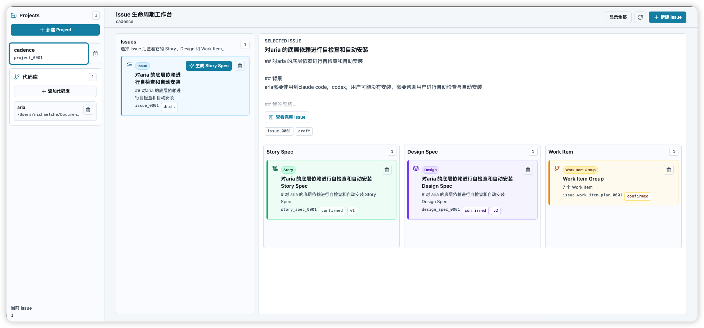

### 2. Project / Repository / Issue 管理

左侧边栏统一管理 Project 与代码库（Repository）：

- 创建 Project 作为需求集合。
- 为 Project 添加本地代码库路径，Issue 自动生成即绑定代码上下文。
- Issue 支持 Markdown 描述、阶段（clarification / development）与状态追踪。

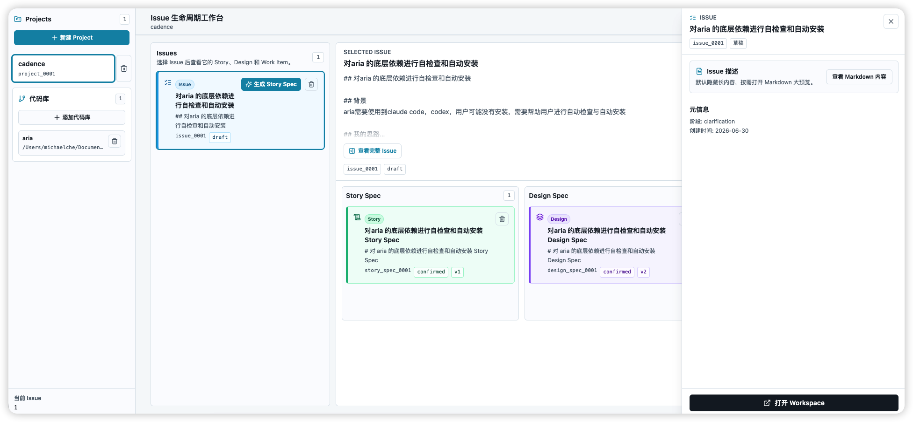

### 3. AI Provider 驱动与依赖自检

Aria 默认依赖 **Claude Code**（必装）与 **Codex**（可选）作为底层执行器。首次启动时会自动检测环境：

- 检测 `node` / `npm` 是否可用。
- 检测 `claude` / `codex` 命令是否在 `PATH`。
- 缺失时通过 `npm install -g` 引导自动安装（不使用官方一键安装链接，便于内网与包管理器同步）。

Provider 架构可扩展，后续可低成本接入 OpenCode、Kimi Code 等新的 AI 执行器。

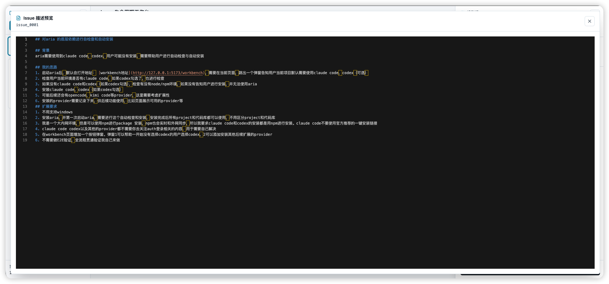

### 4. Story / Design / Work Item 生成与版本历史

每个产物卡片都支持：

- **AI 生成**：从 Issue 或上游产物触发 Provider 生成建议。
- **交叉 Review**：作者 provider 生成 → reviewer provider 审查 → 作者 provider 修订，达到配置轮次后进入人工确认。
- **版本历史**：每次生成与修订都保留版本（v1、v2 …），可查看 Markdown 全文与审核记录。
- **人工确认**：确认后的产物才能进入下游派生。

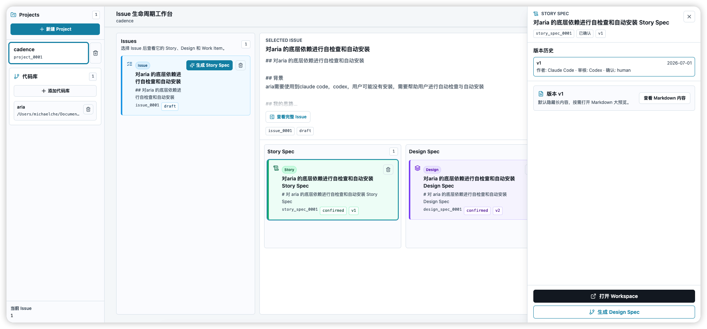

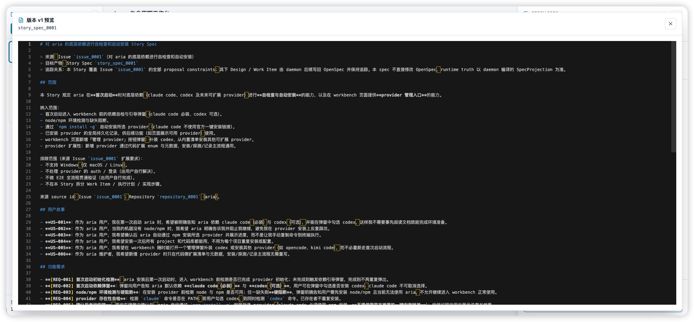

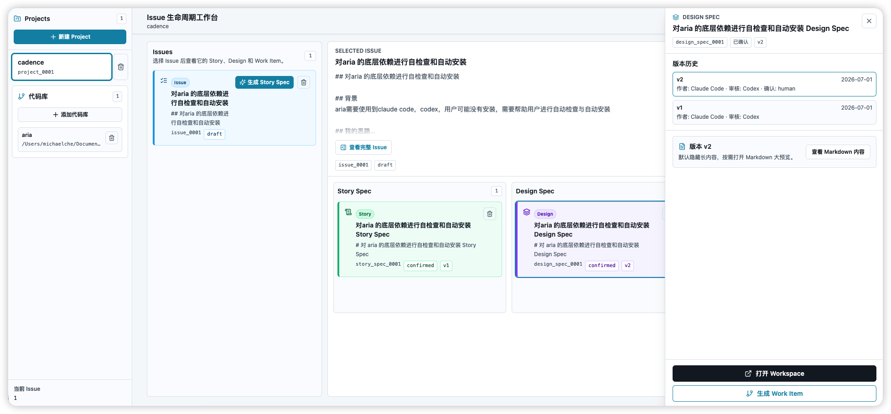

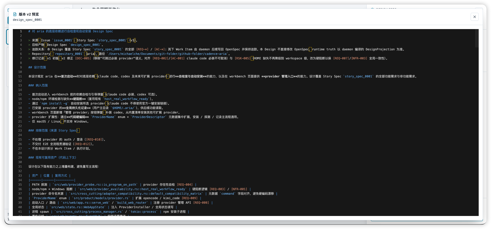

### 5. Work Item Group 与执行计划

Work Item 以 Group 形式组织，包含：

- 依赖图（Dependency Graph）
- 拆分选项（是否拆分前后端、是否包含集成/E2E 测试、是否需要执行计划确认）
- 子 Work Item 明细
- 关联的 Coding Attempt 状态

生成 Plan 并经人工确认后，方可进入 Coding Workspace 执行开发、测试、Review、Rework 与最终验收。

按目标仓库分组展示时，顶部保留唯一的 Work Item Group（Plan）卡片。点击可查看计划状态、来源、子任务、依赖和 Review 状态；通过「打开 Workspace」进入 Plan 工作台，查看完整内容、版本历史和审批记录。计划确认后，由该抽屉统一开始 Coding 或进入已有 Coding Workspace；整组删除也只从该抽屉发起，确认后删除 Plan 及关联子任务，刷新后可重新准备 Work Item Plan。

单个 Work Item 卡片仍可打开详情抽屉；URL 的 `focus=work_item:<issueId>:<workItemId>` 可恢复该任务详情，刷新后使用对应 Issue 的最新数据。归属于 Plan 的 v2 单项仅展示详情，不提供独立 Workspace、Coding 或删除入口；没有 Plan 归属的 v1 单项保留原有操作。

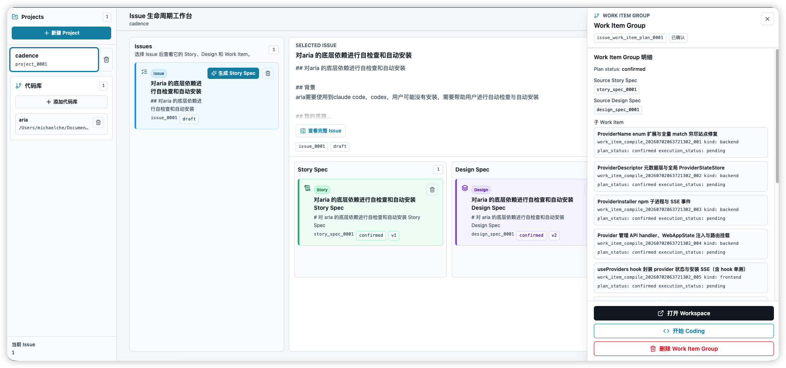

### 6. Provider Workspace 弹窗

统一的对话式工作区承载 Story、Design、Work Item 的全流程：

- 左侧流程轨道显示当前节点与状态。
- 中间对话区展示 provider 输入、输出、澄清问答与用户补充指令。
- 右侧产物区展示 Markdown/JSON 产物、版本历史、Review 意见与确认记录。

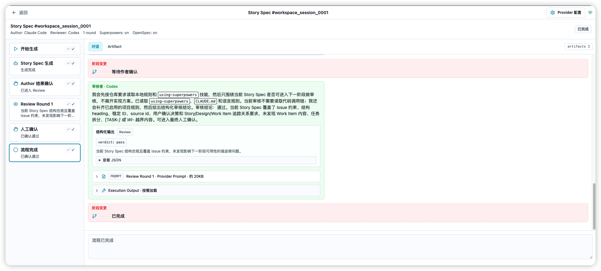

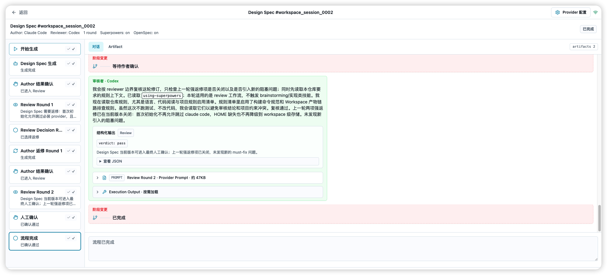

### 7. Coding Workspace

Work Item 确认后进入 Coding Workspace：

- 多角色（Analyst、Planner、Coder、Tester、Reviewer）顺序/并行执行。
- 实时流式事件、权限请求、Stage Gate 与人工确认。
- 支持执行计划变更、Abort、Diff 查看与回滚（Rollback）。

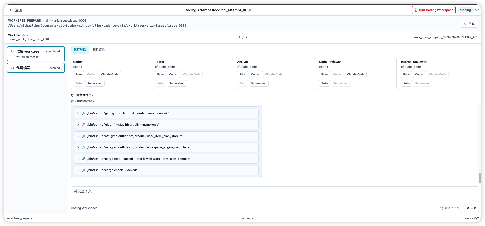

---

## 技术栈

| 层级 | 技术 |
|------|------|
| 后端 | Rust（Edition 2024）、Axum、Tokio、rust-embed |
| 前端 | TypeScript、React 19、Vite、TanStack Router、Zustand、Tailwind CSS、Monaco Editor |
| 测试 | Rust 集成测试 / 单元测试、Vitest、Playwright E2E |
| 分发 | npm / npx（`@cadence-aria/cli`） |

---

## 快速开始

### 通过 npx 使用（推荐终端用户）

```bash
npx @cadence-aria/cli
```

启动后将自动打开浏览器并进入 `http://127.0.0.1:<port>/workbench`。

### 本地源码启动

```bash
# 1. 构建前端产物（后端编译时通过 rust-embed 嵌入 web/dist，必须先构建）
pnpm -C web install   # 首次
pnpm -C web build

# 2. 启动后端 + 前端开发服务（推荐：唯一入口脚本，自动带上
#    ARIA_API_TRUSTED_ORIGINS 受信 origin 配置，并做受守卫端点门禁探测）
bash scripts/aria-dev-start.sh

#    裸命令等价写法（需自行设置受信 origin，否则前端 /api 会被后端来源校验 403）：
ARIA_API_TRUSTED_ORIGINS="http://127.0.0.1:5173,http://localhost:5173" \
  cargo run --locked -- web --workspace . --host 127.0.0.1 --port 4317
# 在另一个终端启动前端 dev server
cd web && pnpm dev --port 5173
```

开发模式下前端代理 `/api` 到 `http://127.0.0.1:4317`，访问 `http://127.0.0.1:5173` 即可。

### 环境要求

- macOS 或 Linux（Windows 不在当前支持范围）
- Rust（版本以 `rust-toolchain.toml` 为准）
- Node.js >= 18 与 pnpm
- Claude Code（首次启动时如不存在的会引导安装）

### 挂起检测环境变量（coding provider 零活动看门狗）

coding 执行/审查的共享 provider 流按「距最后真实事件的静默时长」检测挂起：reviewer 5 分钟、coder 10 分钟无任何事件时，先自动用同一 provider 全新重试一次；再次挂起则暂停流程并落「AI 挂起」门（可重试/说明情况后继续/终止），不切换 provider。工具命令未返回期间静默窗口放宽到 30 分钟，避免误杀正常长构建。三项阈值可用环境变量覆写（正整数秒，非法值回默认）：

| 环境变量 | 默认 | 语义 |
|---|---:|---|
| `ARIA_CODING_REVIEWER_IDLE_SECS` | 300 | reviewer（Code Review / Internal PR Review）思考静默挂起界（秒） |
| `ARIA_CODING_CODER_IDLE_SECS` | 600 | coder 思考静默挂起界（秒） |
| `ARIA_CODING_TOOL_INFLIGHT_IDLE_SECS` | 1800 | 工具 call 未返回时的静默挂起界（秒），生效时取与角色界的较大值 |

choice/权限等待人工应答期间看门狗暂停计时，不会把人工等待当挂起。

---

## 开发指南

### 构建与检查

```bash
# 任何 cargo 构建/测试前必须先构建前端产物
pnpm -C web build

# 格式化
cargo fmt --check

# Clippy
cargo clippy --all-targets --all-features --locked -- -D warnings

# 检查
cargo check --locked

# 测试
cargo test --locked

# 前端类型检查
cd web && pnpm tsc -b

# 前端单元测试
cd web && pnpm test
```

> 注意：禁止给 `cargo test` 添加 `-j 1`；并行度由 `.cargo/config.toml` 统一托管。

### npx 本地冒烟

```bash
pnpm -C web build
cargo build --release
node scripts/smoke-npx.mjs
```

详见：

- `cadence/readmes/2026-05-31_README_npx分发开发与发布指南_v1.0.md`
- `cadence/readmes/2026-05-30_README_sccache可选缓存_v1.0.md`
- `cadence/project-rules/build-test-commands.md`

---

## 项目结构

```text
.
├── src/                    # Rust 后端
│   ├── cli.rs              # CLI 入口
│   ├── cross_cutting/      # Provider 适配、进程管理、artifact 校验等
│   ├── daemon/             # 守护进程与状态机
│   ├── interactive/        # REPL / 交互投影
│   ├── product/            # Project / Issue / Repository / WorkItem 等产品索引
│   ├── protocol/           # 协议定义
│   ├── runtime_units/      # 运行时执行单元
│   ├── task_run/           # 任务运行编排
│   └── web/                # Web API、WebSocket、静态资源
├── web/                    # React + TypeScript 前端
│   ├── src/
│   │   ├── components/     # 组件（lifecycle、chat-workspace、coding-workspace）
│   │   ├── pages/          # 页面（Workbench、ChatWorkspace、CodingWorkspace）
│   │   ├── state/          # Zustand 状态
│   │   └── api/            # API 客户端与类型
│   └── e2e/                # Playwright E2E
├── npm/                    # npx 分发包
│   ├── cli/                # JS launcher
│   ├── cli-darwin-arm64/
│   ├── cli-darwin-x64/
│   └── cli-linux-x64/
├── cadence/                # 项目产物文档、设计、计划、规则
│   ├── designs/            # 技术方案
│   ├── plans/              # 计划文档
│   ├── prds/               # 需求文档
│   └── project-rules/      # 项目自定义规则
├── tests/                  # Rust 集成测试
├── scripts/                # 构建与发布脚本
└── README.en.md            # English README
```

---

## 如何使用系统

### 1. 启动与首次环境自检

#### 通过 npx 启动

```bash
npx @cadence-aria/cli
```

launcher 会自动选择空闲端口，启动后端，并打开浏览器进入 `http://127.0.0.1:<port>/workbench`。

#### 本地源码启动

```bash
pnpm -C web build

# 推荐：开发双服务唯一入口（自动带上 ARIA_API_TRUSTED_ORIGINS 受信 origin
# 配置，并做受守卫端点门禁探测；--check 只探测已运行服务）
bash scripts/aria-dev-start.sh

# 裸命令等价写法（需自行设置受信 origin，否则前端 /api 会被后端来源校验 403）：
ARIA_API_TRUSTED_ORIGINS="http://127.0.0.1:5173,http://localhost:5173" \
  cargo run --locked -- web --workspace . --host 127.0.0.1 --port 4317
# 在另一个终端
cd web && pnpm dev --port 5173
```

然后访问 `http://127.0.0.1:5173`，开发模式下前端会把 `/api/*` 代理到 `4317` 端口的后端。

#### 控制面来源校验（Host/Origin）

平台控制面以 Host/Origin 来源校验作为入站边界，**不要求登录、令牌或会话**：

- 所有 `/api/**` 与 `/ws/**`（含 test 路由与别名）在进入 handler / WebSocket upgrade 之前先校验 Host 与 Origin（唯一例外：`GET /api/health` 公开；`POST /api/evidence-query` 按专用 evidence token 语义鉴权，见下节）。
- 请求必须携带允许的 Host（伪造/缺失/与 URI authority 冲突一律 403）；状态变更（POST/PUT/DELETE）与 WebSocket upgrade 必须携带受信精确 Origin（非法 / `null` / 缺失一律 403）；Host 受信时只读 GET/HEAD/OPTIONS 无 Origin 可访问。
  打开页面即用，无需粘贴任何 token。
- 默认受信 Origin/Host 从实际监听地址精确推导（如 `http://127.0.0.1:<port>`、`http://localhost:<port>`）。前端开发服务器（5173）或非回环监听必须显式配置：`ARIA_API_TRUSTED_ORIGINS=http://localhost:5173`（逗号分隔多个；精确 `scheme://host:port`，禁止通配符；非回环 bind 未配置时拒绝启动）。
- 非浏览器自动化（CLI/脚本）：显式携带受信 Origin 头即可访问（写操作必须带）；WebSocket URL 一律不带任何令牌。
- 残余边界（已知并接受）：本机单用户场景下，同 UID 的本机程序可伪造 Host/Origin 访问控制面（与本地开发工具同级暴露面）；网页 drive-by 仍被 Host/Origin 校验挡住。

#### evidence 查询脚本（专用 token，不与管理会话混用）

worktree 内的 `.aria/bin/aria-evidence-query` 脚本走**专用 evidence token 语义**：鉴权由 handler 既有的 token→attempt→role→预算链承担（与运行中 attempt 绑定、仅证据只读）。来源校验中间件对该端点保留 Host/Origin 来源卫生（脚本自动携带 `Origin: http://127.0.0.1:<port>`），body 内的 evidence token 由 `.aria/evidence-token`（0600）提供。残余边界（R9/GC8）：该 token 文件是同 UID 可读材料——来源校验阻止跨站调用，不抵御同 UID 恶意进程截获或复用。

#### 受信执行环境与 Git 禁桥（批2 T2–T5）

- Provider（Claude/Codex/Pi/Kimi）子进程不再继承宿主全部环境：只透传工具链与语言环境白名单（`PATH`、`JAVA_HOME`、`MAVEN_HOME`、`LANG` 等）；代理、包管理器、SSL/CA、容器连接等键必须写进受信 Provider 配置才生效。控制面不签发任何入站令牌/会话材料，evidence 专用 token 也永不进入 Provider 环境。
- 给 Provider 额外环境变量（如 `DOCKER_HOST`、`NODE_OPTIONS`）只能通过受信配置批准，仅设置 shell 变量不再生效。`HOME` 固定为 owner 家目录；同时存在第二个 `CODEX_HOME` 会被拒绝并给出配置发现诊断。
- Provider CLI 以裸名（`claude`/`codex`/`pi`/`kimi`）调用而 `PATH` 不在冻结环境中时，会明确报「缺少工具」，不会回退宿主 `PATH`。平台自身的仓库注册、终审与版本探测已显式携带 `PATH`，不受此影响。
- 平台自己的 Git 操作（提交、worktree、状态、注册快照等）不执行仓库的 hooks 与 fsmonitor：仓库里的 `pre-commit` 等只在你自己终端或 Provider 会话执行 Git 时生效，平台提交不会被 hooks 拦截或偷偷触发。`git push` 到远端时，远端仓库自己的 hooks 仍会执行。
- 取消或失败的运行只回收平台登记的进程组、容器与临时目录；owner 家目录与登记私有根之外的内容永不清理。自行 daemonize、绕过平台登记的后台进程/容器不保证回收，需要时请人工确认后处理。
- 恢复：若运行记录显示资源未静止（存在未知 writer），平台会停等而不是强行继续；按提示人工结束残留进程/容器后可重试。

#### Kimi 执行通道（批2 T6–T8）

- Kimi 终端不再要求把命令包成 `bash -c "..."`：普通 `command` + `args` 原样执行（如 `mvn --version`、`node -e ...`、带空格参数）；只给单个字符串时仍按受信 `SHELL` 的 `-c` 语义执行。
- Kimi 终端直接运行在宿主上，不再尝试 bubblewrap 隔离；写入宿主受管目录是预期行为。并发终端名额在启动失败时立即归还。
- 终端命令不再有固定 120 秒上限：命令时长只受本次 Provider 调用的总 deadline 约束；有终端在活动时不会触发空闲超时，但也不会延长总 deadline。会话结束或取消后新的终端请求会被拒绝，已登记终端会被级联收割。
- 岗位策略：Author 岗位不能用 fs 写接口编辑代码文件（作者文档走平台通道），但读取、终端、报告通道可用；Reviewer 只有在有效评审窗口内才能通过 fs 写接口写入授权根，越界或符号链接逃逸会被拒绝且目标不变。
- 恢复：终端生命周期事件使用稳定的 `kimi_terminal_<id>` 关联；会话取消后不要再等待该终端输出，以事件流中的 Exited/Killed 终态为准。

#### Coder 执行与岗位策略（批2 T9–T15）

- 能力证据换代：旧版本（v1/v2）保存的「全开能力」记录一律按 Unknown 处理，原文件不被改写；需要重新探测确认后才会放行。宿主全开的判定改为「受控宿主写成功即全开事实」，探测必须带岗位、Reviewer 窗口与资源身份，缺一即 Unknown。
- 双阶段准入：只有当前语义 Confirmed 的记录才能同时通过启动与写边界检查；旧的「Unknown 但 actions 命中」迁移放行已删除。Provider 进程统一以受信宿主方式启动，不再有 bwrap launcher。
- 工具策略按岗位：Coder/Reviewer/Orchestrator/Splitter/Handoff 的会话全开（不再注入 deny 文件写内建工具）；Author 岗位只拒绝代码文件写内建工具，文档交付走平台通道。Author 首轮与续跑都绑定同一 Author 合同，模型不能通过 prompt/env 提升岗位。
- Codex：LC 的规划/评审/编码三个动作与 Direct 会话均为 `danger-full-access`，审批为 `on-request`（Auto 的 `never` 只用于非策略会话）；旧的 read-only/workspace-write 记录恢复时会失配并显式开新会话。Author 的 Codex 会话若出现 fileChange 项，平台会持久记录检测事实并把该轮中断为 Failed，迟到事件不会洗白；这只是检测与审计，不宣称回滚已发生的写入。
- Coder 运行有独立的 `code_delivery` 资源窗：取消/失败只清平台登记的临时目录，源码、dirty/staged/commit/HEAD 原样保留，下一轮重试可接着改；未登记的后台进程不保证回收。
- 自跑 CHECK：计划中的验证命令由 Coder 本人执行，并回报实际命令/cwd/退出码/测试数量/原始输出；平台不代跑，A′ 只覆盖外部硬件、人工检查或临时缺项。失败按缺依赖/认证/权限/断言分类展示，原始输出摘录可在分诊卡查看；「重跑」只是唤回原 Coder，不会由平台执行命令。
- 恢复：历史能力记录显示 Unknown 时，在 Provider 能力页重新探测即可（需真机 CLI 可用）；探测被拒签通常表示缺少岗位/窗口/资源身份，而非 CLI 不可用。

#### Reviewer 评审窗口（批2 T16–T21）

- 每次评审在受管 worktree 上开一个 durable 窗口：同一棵树同时只能有一个评审窗口。开窗前先冻结平台写通道并等待在途 Git 写入真实退出，再停 Coder 资源并确认静止，然后采基线；材料采集只在窗口 Running 后开始。
- 评审结束后按基线恢复：Reviewer 的修改/新增/删除痕迹被清除，Coder 原有的 staged/unstaged/untracked/ignored/dirty、commit、HEAD 原样保留，不使用 `git clean` 或整树 reset。平台合法写入域发生漂移时窗口会停等（RecoveryRequired）而不是伪称恢复完成，处置后重入可续接。
- 违规判定：自提交、改 Git 域（HEAD/index/refs）、改平台元数据、绕过写通道、可观察 journal 篡改等整轮 Invalidated，旧报告永久不可 Accepted，只能人工裁决（作废或要求新评审）。push 类外部副作用不可回滚，报告只如实标注。
- 采信门：内容 approve 但报告未被采信（Pending/Invalidated）时不会推进交付，会落人工分诊门；Runner 交付前会再查一次采信状态。窗口冻结期间平台的 stage/commit/push 与取消补偿全部拒绝，释放后自动续接。
- 四家 Reviewer 都与窗口合同绑定：Reviewer 会话缺窗口或空窗直接 0 会话启动；规划面评审（Story/Design/WorkItemPlan）也开窗，聚合视图锚主成员 checkout（非主成员面不对账，事件中会注明）。Reviewer 可用全部工具，验证临时文件允许，轮次结束按基线恢复对账。
- 启动与恢复：平台启动时先补偿未终态窗口再放行 Runner；人工门中的 attempt 显示 AwaitingManualRecovery。用 `POST /api/coding-attempts/{attempt_id}/reviewer-window:resolve`（`decision` = `invalidate` | `require_new_review`）裁决：`invalidate` 后 attempt 不自动恢复，`require_new_review` 会另取租约与新基线。删除/终止 attempt 会先收口窗口并保留 Coder dirty；未知 writer 未静止时窗口持锁停等。

#### 首次启动依赖自检

首次启动时 Aria 会检查环境：

- `node` / `npm` 是否可用；
- `claude`（Claude Code，必装）是否在 `PATH`；
- `codex`（可选）是否在 `PATH`。

如果缺失，会弹出引导窗口，提示通过 `npm install -g` 安装对应 Provider。Claude Code 必须安装后才能继续使用；Codex 可跳过，日后再通过右上角 **Provider 配置** 补装。

---

### 2. Workbench 主界面

默认进入 `/workbench`，页面分为三块：

- **左侧边栏**：Project 列表、当前 Project 的代码库列表、当前 Issue 数量。
- **Issues 列**：当前 Project 下的所有 Issue。
- **右侧详情区**：选中 Issue 后，展示该 Issue 派生的 Story Spec、Design Spec 和 Work Item 卡片。

---

### 3. 创建 Project

1. 点击左侧边栏顶部的 **+ 新建 Project**。
2. 输入 Project 名称。
3. 创建后，该 Project 会出现在列表中并被自动选中。

Project 是需求的集合，后续所有 Issue、Repository、Spec 和 Work Item 都挂在 Project 下。

---

### 4. 添加代码库（Repository）

Issue 必须绑定代码库上下文，Story / Design / Work Item 的生成和执行都依赖这个上下文。

1. 在左侧边栏的 **代码库** 区域点击 **+ 添加代码库**。
2. 输入本地代码库的绝对路径。
3. 保存后，该 Repository 会显示在列表中，包含名称与路径。

如果路径后续失效，相关 Issue 与派生卡片会进入 blocked 状态，需要重新绑定或修复路径。

---

### 5. 创建 Issue

1. 点击 Issues 区域附近的 **+ 新建 Issue**。
2. 选择要绑定的 Repository。
3. 输入标题和 Markdown 描述（背景、思路、约束等）。
4. 保存后，Issue 以 `draft` 状态出现在 Issues 列表。

点击某个 Issue 卡片进入**聚焦态**：右侧详情区只展示该 Issue 派生的 Story Spec、Design Spec 和 Work Item。

---

### 6. 生成 Story Spec

1. 在 Issues 列表中选中目标 Issue。
2. 点击 Issue 卡片上的 **生成 Story Spec**。
3. 系统打开 **Provider Workspace 弹窗**：
   - **左侧流程轨道**：固定节点与当前状态（准备上下文、建议拆分、生成草稿、交叉 Review、修订、人工确认）。
   - **中间对话区**：Provider 基于 Issue 描述和代码上下文给出拆分建议，用户可以补充指令、回答澄清问题。
   - **右侧产物区**：生成的 Markdown 产物、版本历史、Review 意见。
4. Provider 可能会建议把一个 Issue 拆成多个 Story Spec。
5. 用户审核拆分建议后，确认创建对应 Story Spec 卡片。
6. Story Spec 卡片显示为 `confirmed` / `v1` 等状态。

---

### 7. 生成 Design Spec

Design Spec 只能从**已确认**的 Story Spec 派生。

1. 在右侧详情区选中一个已确认的 Story Spec。
2. 点击 **生成 Design Spec**。
3. 在 Workspace 弹窗中，Provider 建议：
   - Story 到 Design 的映射（一对一或多对一）；
   - Design 类型：`frontend`、`backend`，或两者都有。
4. 用户审核映射和类型后，确认创建 Design Spec 卡片。
5. 每张 Design Spec 同样支持多版本、交叉 Review 和人工确认。

---

### 8. 生成 Work Item Plan 与 Work Item

Work Item 必须由 Story Spec 与 Design Spec 联合派生。

1. 选中已确认的 Story Spec 和 Design Spec。
2. 点击 **生成 Work Item** / **生成 Work Item Plan**。
3. 系统弹出 **Work Item Plan 配置弹窗**，可配置：
   - 是否包含集成测试（`include_integration_tests`）；
   - 是否包含 E2E 测试（`include_e2e_tests`）；
   - 是否强制前后端拆分（`force_frontend_backend_split`）；
   - 是否需要执行计划人工确认（`require_execution_plan_confirm`）。
4. 确认配置后，Provider 生成 Plan，包含：
   - 子 Work Item 列表；
   - Work Item 之间的依赖图（Dependency Graph）；
   - 拆分结论与校验发现（validator findings）。
5. 用户查看 Plan 后点击确认，Work Item Group 卡片创建成功。
6. Work Item Group 卡片内展示子 Work Item 明细和关联的 Coding Attempt 状态。

**关键规则**：Work Item 必须先有 Plan 并经人工确认，才能进入 Coding 阶段。

---

### 9. Provider Workspace 弹窗的通用操作

无论是 Story、Design 还是 Work Item，Workspace 弹窗的交互模式一致：

- **顶部配置条**：可查看或调整 Provider 组合、Review 轮次、superpowers / OpenSpec 约束、Repository 上下文。
- **左侧流程轨道**：固定节点，显示当前进行到哪一步。
- **中间对话区**：
  - 查看 Provider 的输入摘要；
  - 查看 Provider 的流式输出；
  - 输入补充要求或回答澄清；
  - 查看权限请求、Review 结论、阶段变更。
- **右侧产物区**：
  - 查看 Markdown / JSON 产物全文；
  - 切换版本历史（v1、v2 …）；
  - 查看 Review 意见链；
  - 查看确认记录。

流程到达人工确认节点时，会暂停等待用户点击确认；如果不通过，可要求修改，进入下一轮修订。

---

### 10. 进入 Coding Workspace

1. 在 Work Item Group 或单个 Work Item 卡片上点击 **打开 Workspace** / **开始 Coding**。
2. 系统进入 `/workbench/coding/$attemptId`，即 Coding Workspace。

Coding Workspace 中的典型流程：

- **Analyst**：分析需求与代码上下文；
- **Planner**：制定执行计划；
- **Coder**：按 plan 修改代码；
- **Tester**：运行测试、验证结果；
- **Reviewer**：审查改动。

每个角色运行时都会通过 WebSocket 实时推送事件，界面左侧显示 Timeline，中间显示对话与输出，右侧显示 Artifact / Diff / 测试报告。

过程中可能触发以下交互：

- **权限请求**：Provider 需要执行敏感操作（如写入文件、运行命令）时，弹出授权请求；
- **Stage Gate**：到达关键节点暂停，等待人工确认继续、要求修改或终止；
- **执行计划变更**：用户可申请修改执行计划，Provider 重新评估；
- **Abort**：随时中断当前 Coding Attempt；
- **Rollback**：如果执行结果不满意，可回退到之前状态。

---

### 11. 删除 Project / Issue / 产物

Workbench 支持直接删除：

- **Project**：左侧边栏点击项目卡片旁的删除按钮；
- **Repository**：代码库列表点击删除按钮；
- **Issue**：Issues 列表点击 Issue 卡片旁的删除按钮；
- **Story Spec / Design Spec / Work Item**：右侧详情区点击卡片上的删除按钮。

删除通常是 soft-delete，产品索引层保留记录，必要时可从 runtime 重建。

---

### 12. 刷新与状态查看

- 页面会自动轮询当前 Project 的 Issues、Repositories、Lifecycle 数据。
- 点击 **刷新** 按钮可手动同步最新状态。
- Issue 和产物卡片会显示当前状态、版本号、确认状态、更新时间。
- 当前 Project 的 Issue 总数显示在左侧边栏底部。

---

### 13. 命令行补充操作

除了 Web 界面，Aria 也提供 CLI：

```bash
# 查看 daemon 状态
aria daemon status --workspace .

# 启动 daemon
aria daemon run --workspace .

# 直接运行一个 task
aria task run --workspace . "你的需求描述"

# 启动 web 服务
aria web --workspace . --host 127.0.0.1 --port 4317
```

> 悬空引用（已删实体留下的旁支记录）的巡检与销账**不提供 CLI 入口**：服务启动时
> 自动跑一次，按「白名单类型 + 证据达标」自动销账，并把巡检清单写到
> `cadence/analysis-docs/<运行日>_分析报告_悬空引用巡检清单_v1.0.md` 供事后查。

不过日常主要操作都通过 `/workbench` 工作台完成。

---

## 许可证

[MIT](LICENSE)
