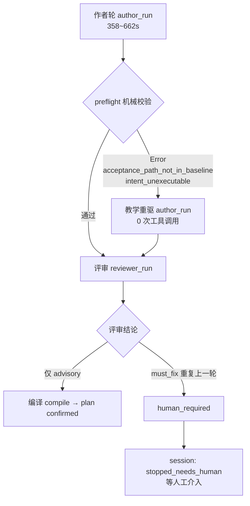

# 分析报告：WIG（Work Item Plan 生成）产品流程实测与根因锁定

- 日期：2026-11-09
- 版本：v1.0
- 范围：`work item plan` 生成全流程（作者 → 机械预检 → 评审 → 编译 → 确认）的**产品真实链路**实测
- 关联：`cadence/analysis-docs/2026-11-08_WIG实测证据基线_v1.0.md`（历史 run 证据基线）、`cadence/designs/2026-11-08_技术方案_WIG生成加速与收敛性加固_v1.0.md`
- 复现材料：`cadence/analysis-docs/wig-product-flow-2026-11-09/`（收割脚本 + 原始输出 + 复现说明）

---

## 1. 结论摘要

1. **effort 档位不是杠杆**。产品全流程串行交替对照（n=2/档，唯一变量 = author/reviewer 的 effort 档位）：质量与收敛性指标（作者轮次、重写轮次、preflight 失败、需人工介入、编译、最终 plan 的 cross-WI 越界）**两档完全一致**；token 维度 high 省 37.6% input，墙钟维度 high 反而慢 51.5%（两者 p=0.339，n=2 不显著）。
2. **抱怨①的根因是"作者单轮本身就要 6~11 分钟"**，不是排队或调度。成功路径端到端 8~11 分钟，其中作者轮占 70~87% 墙钟；作者 prompt 32,609 字符（≈9,058 tokens）且允许 25 次工具调用。
3. **抱怨②在当前产品里的主因已不是 IR 编译失败**，而是 **preflight 机械校验**的两个错误码：`acceptance_path_not_in_baseline`、`intent_unexecutable`。2/4 命中。
4. **抱怨③（评审反复失败→自动预算耗尽→人工介入）实测复现，命中率 50%（2/4）**，链路为：preflight Error → 教学重驱 → 评审报**重复** must_fix → 平台纪律触发 → 改判 `human_required` → session 终态 `stopped_needs_human`。
5. **重驱本身是有效的，坏在"评审对已修好的产物重复报错"**。xhigh-4324 的重驱把 `intent_target_codebase` 从聚合根视图 ID 改成授权逻辑代码库 ID，机械报告重算后该错误**已消失**；但第二轮评审 prompt 里的 `Previous Review Round Findings` 把上一轮的同码 finding 原样列为待办，评审被锚定 ⇒ 重复报 4 条 must_fix ⇒ 升级人工。
6. **最高杠杆的优化是把 plan 基线树清单注入作者 prompt**：规则已经在 prompt 里，清单没有。真实案例 frontend 基线树仅 11 个路径且**完全没有 tests/ 目录**，作者却写了 `frontend/tests/integration/notice-delete-e2e.mjs` 与 `/tmp/notice-delete-e2e.mjs` ⇒ 必然越界。三仓全量清单仅 ≈491 tokens（占 prompt 5.5%）。

---

## 2. 测量装置与可信度

### 2.1 两层测量

| 层 | 装置 | 变量 | n | 用途 |
|---|---|---|---|---|
| 装置级（既有基线） | provider_run 只换 effort，关闭 codegraph / reviewer / 编译重驱链 | effort 档位 | 4/臂 | 隔离 effort 纯效应 |
| **产品全流程（本次）** | 完整 WIG 自动化 enrollment（作者+机械预检+评审+编译+确认），串行交替 | effort 档位 | 2/档 | 测真实链路的收敛性与代价 |

两层口径不同，**不可直接合并**：装置级不含 reviewer 与预检，产品级含全部环节且端到端墙钟。

### 2.2 产品全流程装置

- 真实案例：`公告删除`（issue_0001，仓库 `test-center-java` 三成员仓 busi/frontend/gateway）
- 每臂交替执行（`xhigh → high → high → xhigh`），**同一时刻只跑一个**，消除 proxy 资源竞争与顺序效应
- 每轮独立工作区副本 + 独立端口（4321/4322/4323/4324），从 `prepare` → `Enable` → autopilot 全流程
- 采集自持久化产物：`workspace-timelines/*/timeline_node_details`（节点耗时/工具调用/usage/verdict）、`candidate-attempts.jsonl`（平台 compiler 的 IR 判定）、`work-item-plan-sources/*`（source revision + 机械报告 + 候选 IR）、`automation-enrollment.json`（会话终态）

### 2.3 局限（必须计入结论强度）

- **n=2/档**，置换检验 p=0.339 ⇒ 性能维度差异**不显著**，只能下"无明显效应、且方向与直觉相反"的结论，不能下"high 更快/更省"的结论。
- **单一案例**（同一 issue、同一仓库、同一 agent 配置）⇒ 外部效度有限。
- run 3 在人工门后**未继续**：该 session 被 enrollment 精确绑定，`workspace_session_takeover` 被服务端拒绝（`workspace_session_takeover_not_allowed`），而 `automation-enrollment/continue-plan` 需要完整 binding 载荷与 stop key，未构造。故 run 3 终态记为 `stopped_needs_human`，"人工批准后能否完成"未测。
- 统计口径：中位数 + 置换检验（20,000 次，seed=23）。

---

## 3. 四个 run 的完整链路

### 3.1 逐 run 明细

| # | 档位 | 节点序列（耗时 / 工具调用） | 墙钟 | usage (in/out/cache) | 预检码 | 终态 | 最终 plan |
|---|---|---|---|---|---|---|---|
| 1 | xhigh | author 358.1s/25 → reviewer 124.6s/14 → compile 1.0s | 483.7s | 78,127 / 25,236 / 155,120 | — | `confirmed` | 4 WI，cross-WI **0/21** |
| 2 | high | author 579.9s/22 → reviewer 75.4s/14 → compile 1.2s | 656.4s | 63,057 / 19,903 / 181,120 | — | `confirmed` | 4 WI，cross-WI **0/19** |
| 3 | high | author 661.8s/12 → **预检 0.1s/0** → **重驱 author 152.4s/0** → reviewer 106.9s/15 | 921.3s | 63,386 / 22,034 / 292,387 | `acceptance_path_not_in_baseline` | **`stopped_needs_human`** | draft，cross-WI 0/14 |
| 4 | xhigh | author 420.2s/11 → **预检 0.1s/0** → **重驱 author 26.4s/0** → reviewer 111.2s/10 | 558.0s | 124,436 / 23,353 / 234,302 | `intent_unexecutable` | **`stopped_needs_human`** | draft，cross-WI 0/25 |

- 2 个成功 run 的 **IR 判定均为 `passed`（首次尝试即通过）**；平台 `candidate-attempts.jsonl` 对 4 个 session 全部未记录 `failed` ⇒ **IR 编译失败在本次 4 次中未复现**。
- 4 个 run 的最终 source **cross-WI 越界均为 0**（合计 0/79）⇒ 跨 WorkItem 成员校验未出问题。
- 2 个成功 run 的 plan 均带 1 条 validator warning：`integration_or_e2e_skipped_risk`。
- 2 个失败 run 的 plan 停在 `draft`，`work_item_ids` 为空 ⇒ 未进入编译。

### 3.2 effort 档位对照（n=2/档）

| 指标 | xhigh | high | 差 (high−xhigh) | 置换 p |
|---|---|---|---|---|
| 墙钟合计 s | 520.8 | 788.8 | +268.0 (+51.5%) | 0.3393 |
| input token | 101,281.5 | 63,221.5 | **−38,060.0 (−37.6%)** | 0.3393 |
| output token | 24,294.5 | 20,968.5 | −3,326.0 (−13.7%) | 0.3393 |
| cache_read token | 194,711.0 | 236,753.5 | +42,042.5 (+21.6%) | 0.6691 |
| codegraph 调用 | 2.5 | 3.5 | +1.0 (+40.0%) | 1.0000 |
| 作者轮次（含重写） | 1.5 | 1.5 | **0** | — |
| reviewer 轮次 | 1.5 | 1.5 | **0** | — |
| 重写轮次 | 0.5 | 0.5 | **0** | — |
| preflight 机械校验失败 | 0.5 | 0.5 | **0** | — |
| 需人工介入次数 | 0.5 | 0.5 | **0** | — |
| 编译次数 | 0.5 | 0.5 | **0** | — |
| reviewer findings 合计 | 9 | 6 | −3 | — |
| 最终 plan cross-WI 越界 | 0/46 | 0/33 | — | — |

**读法**：收敛性/质量维度**完全无差异**（所有计数项差为 0）⇒ effort 档位对这些失败路径**无因果影响**。性能维度方向相反且 p=0.339 ⇒ 只能说"未观测到可靠差异"。

### 3.3 失败路径的分布

| 失败模式 | 命中 | 档位分布 |
|---|---|---|
| preflight 机械校验失败 | 2/4 (50%) | xhigh 1、high 1 ⇒ **与档位无关** |
| 教学重驱 | 2/4 (50%) | xhigh 1、high 1 |
| 升级 `human_required`（等人工） | 2/4 (50%) | xhigh 1、high 1 |
| IR 编译失败 | 0/4 | — |
| cross-WI 越界 | 0/4 | — |

---

## 4. 三个抱怨的真实机制

### 4.1 抱怨①：慢，"启动一次要 5~10 分钟才会有 token 输出"

实测：成功路径端到端 483.7s / 656.4s（8~11 分钟）；**作者单轮 358.1s / 579.9s / 661.8s / 420.2s**（6~11 分钟），占各自总墙钟的 **74% / 88% / 72% / 75%**。

⇒ 「启动后长时间无输出」= **作者单轮自身的推理时长**，不是调度排队、不是锁等待、不是首 token 传输慢。作者 prompt 32,609 字符（≈9,058 tokens），允许 25 次工具调用（read/grep/glob/bash/codegraph），单轮工具调用本身就占 6~11 分钟。

补充：重驱轮次只有 0 次工具调用（26.4s / 152.4s），说明**重驱阶段模型不查仓库**，只能凭 prompt 里的零散路径示例盲改（见 4.3）。

### 4.2 抱怨②："IR 校验失败（unknown_requirement_ref / acceptance_criterion_without_reviewer_check）的教学重驱"

**这两个码在本次产品链路中没有出现**。平台 compiler 对 4 个 session 全部判定 `passed`。当前实际触发重驱的是 **preflight 机械校验**：

| 错误码 | 语义 | 命中 run |
|---|---|---|
| `acceptance_path_not_in_baseline` | AC/验证计划引用的仓库内路径不存在于 plan 基线树 | run 3（high） |
| `intent_unexecutable` | intent target 逻辑代码库不在授权逻辑代码库清单 | run 4（xhigh） |

run 3 的原始 verdict（0.1s，0 工具调用）：

> `[acceptance_path_not_in_baseline] work item WI-004 的验收标准/验证计划引用路径 [tests/integration/notice-delete-e2e.mjs] 不存在于 plan 基线树；修复动作：删除引用基线外路径的验收标准（AC），或改用 plan 基线树内存在的既有路径……`

⇒ **抱怨②的诉求依然成立，但靶子换了**：问题不是 IR 编译器，而是"作者无从得知基线树里有什么"。

### 4.3 抱怨③："reviewer 失败→再次生成→reviewer 再失败→重复多次直到自动化消耗殆尽人工介入"

**完整链路实测复现（2/4）**：



关键证据（run 4 / xhigh-4324）：

1. **重驱修好了**：`intent_target_codebase` 从 `lc_aggregate_root_view_7cb8c0b4-…` 改为 `7cb8c0b4-…`（授权逻辑代码库 ID）。两个 source revision 哈希不同（`aa45c70f` → `21c01e3a`），**内容确实变了**。
2. **机械侧已清零**：第二版机械报告 `report-940670d1ca432976.json` 绑定 `source_revision_id = source-21c01e3a8c35e42b`，findings 只剩 1 条 warning，`intent_unexecutable` **消失**。
3. **评审却重复报错**：第二轮评审 prompt 引用的是新 revision（`21c01e3a…`）、机械报告里也没有该码，但输出 4 条同码 must_fix。原因是 prompt 里有：

```text
### Previous Review Round Findings
{
  "current_plan_candidate_ir_ref": ".../ir-21c01e3a8c35e42b",
  "note": "上一轮评审已登记的 finding 身份；fingerprint 是其稳定身份指纹",
  "previous_findings": [
    { "contract_field": "plan_preflight.intent_unexecutable",
      "fingerprint": "6c7fafeb844a8c8f136b00970cf51450419f9ec26eac811a1a83f5a83e5d0561",
      "required_action": "按 finding 消息修复 intent_unexecutable" },
    ... ×4
  ]
}
```

   ⇒ **已解决的 finding 被原样当作"待办清单"继续呈现**，评审被上一轮锚定，对已修好的产物重复报错。
4. **平台的防重复规则被动触发**：同一 prompt 里有 `[review_repetition_discipline]`——「若本轮 findings 与你上一轮实质相同…不得再次返回 revise：改判 needs_human…不要对同一批未解决 findings 无限第 N 次 revise」。评审最终确实改判了 `human_required`，但**代价是整条自动化链停死等人**。

⇒ 这解释了用户观察到的"重复多次直到自动化消耗殆尽人工介入"：**不是模型能力不足，是评审输入把已解决项当待办，加上评审输出无法做到"逐条比对后再报"**。

### 4.4 一个被忽略的事实：评审侧也有同一根因

成功 run 的评审 advisory 里反复出现同一主题（4 次 run 中 2 次）：

> WI-003 的三条验收标准都要求 `non_zero_test_execution` 证据，但唯一对应的 CHECK-005 命令字段为空、断言脚本又落在仓库外的 `/tmp` 目录下，该验收证据无法由他人复跑复现。

> 前端脚本化校验在计划指定的环境里跑不起来：所要求的 jsdom 并不在前端依赖中…脚本放在 /tmp，容器内也解析不到…

⇒ 与 preflight 失败**同源**：作者把验证脚本写在仓库外路径，而作者/评审**都看不到基线树清单**，评审只能给出"不可归因"的软性缺陷。

---

## 5. 优化点（按杠杆/成本排序）

### O1【最高杠杆】把 plan 基线树清单注入作者 prompt

**问题（有直接证据）**：作者 prompt 已有**规则**但没有**清单`。

- 规则存在：`src/product/work_item_split_engine/prompts.rs:347` —「AC 与验证计划引用的仓库内文件路径必须存在于 plan 基线树…缺失 → `acceptance_path_not_in_baseline` Error；修复动作：{acceptance_baseline_repair_action}」
- 清单不存在：首轮 prompt 32,609 字符、重驱 prompt 34,173 字符，**两者都不含** `base_tree` / `tree_paths` / `available_paths` / `existing_paths`；prompt 里出现的仓库路径是来自 issue/story/design 的**零散示例**，不是完整基线。
- 数据源现成：`src/product/workspace_engine/plan_preflight.rs:132 plan_baseline_tree()`（`git ls-tree -r --name-only refs/heads/<base_branch>`）。

**真实案例的基线树规模（成本上限）**：

| 成员仓 | 基线路径数 | 全量清单字节 | ≈ tokens |
|---|---|---|---|
| busi | 20 | 1,038 | 288 |
| frontend | **11** | 153 | 42 |
| gateway | 12 | 583 | 161 |
| **合计** | 43 | 1,774 | **≈491** |

⇒ 注入成本 ≈491 tokens，占作者 prompt（9,058 tokens）**5.5%**。

**收益（可预判）**：frontend 基线树**完全没有 `tests/` 目录**，作者写的 `frontend/tests/integration/notice-delete-e2e.mjs` 与 `/tmp/notice-delete-e2e.mjs` 在拿到 11 行清单后**无路可错** ⇒ 直接消掉 `acceptance_path_not_in_baseline` 这一失败模式；同时消掉评审侧 `verification_unattributable` 的一大半来源。

**必须配套**：prompt 里已写「若验收依赖本次交付新建的文件，先将其作为独立提交纳入基线」，但**没给这项声明的语法**；需给出「新建路径声明」的字段形状，否则作者会从"引用基线外路径"直接跳到"不写验收"。

### O2【高杠杆】消除"已修复 finding 被重复报"的锚定

**问题**：run 4 实测——重驱修好了，机械报告清零了，评审却因 `Previous Review Round Findings` 锚定重复报 4 条 must_fix ⇒ 升级人工。

**修法**：在该段每条 previous finding 上按 `fingerprint` 附**本轮复算状态**（`resolved_in_current_revision: true|false`，由本轮机械报告 findings 的 fingerprint 求交得出）。已解决项显式标注「本轮机械复算已解决，无需再次修改」，并从评审的"待办"语义降级为"历史记录"。

**注意**：不能只靠 prompt 文案——`[review_repetition_discipline]` 已经在 prompt 里却仍被触发（因为它要求模型自行判断"实质相同"）。**判定"是否已解决"必须是机械的**（fingerprint 复算），不能让模型判。

### O3【中杠杆】评审侧同源注入 + 缺陷判定口径收紧

- 评审 prompt 注入同一份基线树清单（同 O1 数据源）。
- `verification_unattributable` 的判定改为「引用路径 ∉ 基线树 **且** 无新建路径声明」才报，避免把"基线内可复跑脚本"误判为不可归因。

### O4【次要】重驱必须拿到与作者同源的清单

run 3 / run 4 的重驱轮次工具调用均为 **0**（26.4s / 152.4s）⇒ 重驱阶段模型**不查仓库**，只能盲改。重驱 prompt 与作者 prompt 同源注入基线树清单后，重驱才是"定向修正"而不是"重掷骰子"。

### 不建议的方向

- **不建议用 effort 档位做优化杠杆**：n=2/档下质量/收敛性维度差为 0，性能维度 p=0.339 无法判定，且方向与直觉相反（high 更省 token 但更慢）。要换档位，应基于更大 n 与固定其它变量的单独实验，而不是混在端到端链路里。
- **不建议先动 IR 编译器**：本次 4/4 IR 一次通过，IR 不是当前失败源。

---

## 6. 预期收益与验证口径

| 优化点 | 直接消除的失败模式 | 可度量指标（改动后按同装置重测） |
|---|---|---|
| O1 | `acceptance_path_not_in_baseline`（2/4 run 的失败直接原因） | preflight 失败率 50% → 0%；`verification_unattributable` advisory 数 |
| O2 | 重驱后重复报 ⇒ `human_required`（2/4 run 的终点） | 需人工介入率 50% → 0%；重复 fingerprint 的 finding 数 |
| O3 | 评审侧"不可归因"软缺陷 | advisory 中 `verification_unattributable` 计数 |
| O4 | 重驱盲改 | 重驱轮工具调用数（0 → >0）、重驱后首过率 |

**重测装置要求**：沿用本次串行交替脚本（唯一变量 = 单个优化点），n 至少 4/臂，报告预检失败率、需人工介入率、作者轮数、墙钟、usage 五项。

---

## 7. 证据文件

| 文件 | 内容 |
|---|---|
| `cadence/analysis-docs/wig-product-flow-2026-11-09/harvest_serial.py` | 收割器：从持久化产物还原节点耗时/usage/预检码/IR 判定/cross-WI/会话终态，并做置换检验 |
| `cadence/analysis-docs/wig-product-flow-2026-11-09/harvest_output.txt` | 本报告全部数字的原始输出 |
| `cadence/analysis-docs/wig-product-flow-2026-11-09/reproduce.md` | 复现步骤（工作区副本、端口、prepare/Enable 时序注意点） |
