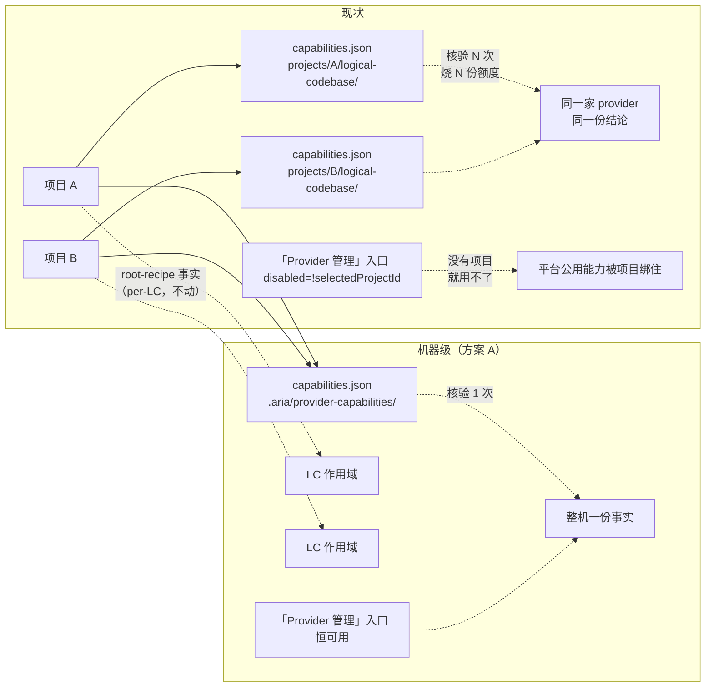

# 技术方案：provider 能力核验机器级化（核验只核验一次，机器一份事实）

日期：2026-11-05
工作树：`.worktrees/bugfix-b-11-02`（分支 `bugfix-b-11-02`）
契约：`openspec/changes/globalize-provider-capability-verification/`（proposal / design / 两份 spec delta / tasks）
本文定位：owner 可读的技术方案（事实 → 方案 → 改动面 → 风险 → 验收）。**精确实施步骤由 `writing-plans` 写入 `cadence/plans/`。**

---

## 1. 触发

owner 2026-11-05 在真机验收时提出：

> 「得有项目才能操作 provider 吗？provider 不是项目的附属，是平台的公用能力。」

实测确认：**是，必须有项目**。两个硬证据：

```
① web/src/components/lifecycle/ProjectSidebar.tsx:242
     disabled={!selectedProjectId}          ← 无选中项目 ⇒ 入口置灰
② .aria/projects/{project_id}/logical-codebase/capabilities.json
                                              ← 记录挂在项目下
```

owner 判断成立。同一仓里 provider 的**其它面早已是机器级**：

| 面 | 作用域 | 证据 |
|---|---|---|
| CLI 安装 / 更新 | **机器级** | `/api/providers/install-targets`、`/api/providers/{target}/install`；装在 `~/.kimi-code`、fnm 全局目录 |
| 健康探测 | **机器级** | `/api/providers/status`、`/api/providers/recheck` —— handler 内 `project_id` / `projects_root` **grep 零命中** |
| **能力核验** | **项目级** | ← 唯一的例外 |

⇒ 「安装与健康是机器级、唯独能力核验按项目切了一份」是真实的不一致。

---

## 2. 事实基础（全部实测，不是推断）

### 2.1 能力探针与项目无关

| 事实 | 位置 |
|---|---|
探针跑在 `std::env::temp_dir()` 下的**临时目录**（`aria-capability-revalidate-{uuid}`），跑完清理 | `src/product/logical_codebase/provider_capability_revalidate.rs:475-485`、`:268`、`:291` |
fixture 是**自造材料**：假 `AGENTS.md`（`# lc root`）、假 `.mcp.json`、假 `.aria/state.json`、假 `root/member-a/member-b/home/target-wt`、`git init` | `src/product/logical_codebase/provider_boundary_probe.rs:348-452` |
**不读**真实聚合根 / 成员仓 / 项目 policy artifact / root-recipe / trust registry；唯一真实输入 = 宿主 PATH 上该 CLI 的存在与版本 | `provider_boundary_probe.rs:365-452`、`:1515-1533`（projection 用固定占位 digest 直构） |
记录字段**无任何** project_id / lc_id / 路径字段；绑定只发生在**文件位置层** | `src/product/logical_codebase/provider_capability_store.rs:541-561`、`:878-886` |

⇒ **能力是整机事实**，与项目 / 逻辑代码库 / 聚合根 / 成员仓 / 规则 / 信任登记均无关。

### 2.2 唯一两处项目绑定

| 字段 | 性质 | 位置 |
|---|---|---|
`root_recipe_evidence` | **per-LC 事实**：绑某 LC 的 root recipe 是否交付；凭据有效性按该 LC 的 durable operation Running 状态重核验 | `provider_capability_store.rs:205-208`；`src/product/logical_codebase/production_policy_resolvers.rs:361-419`、`:382-402` |
`probe_artifact_ref` | 指向**项目级**证据目录 `capability-evidence/boundary` | `provider_capability_revalidate.rs:462-471` |

### 2.3 存量近乎为零

共享验收实例实测：`.aria/projects/project_0001/logical-codebase/` 下**没有** `capabilities.json`（核验从未成功过）⇒ 存量面近乎为零。

---

## 3. 方案选择

| | **A. 两层分离（owner 已选）** | B. 全机器级 | C. 只解前端门控 |
|---|---|---|---|
通用能力证据（版本 / 方言 / 三格矩阵 / 执行语义） | 机器级一份 | 机器级 | **仍按项目** |
`root_recipe_evidence` | **拆出**，per-LC 独立事实 | 塞进机器级记录 ❌ 把 per-LC 事实写死成整机事实 | 随项目 |
探针证据目录 | 机器级 | 机器级 | 项目级 |
没有项目能用 | ✅ | ✅ | ✅（但还得有个项目当壳） |
多项目重复核验 / 重复烧额度 | ❌ 不重复 | ❌ 不重复 | ⚠️ **仍重复** |
root-recipe 判定语义 | 不变 | **会失真** | 不变 |
改动面 | 存储 + 端点 + 内部消费 + 前端 + 夹具 | 同 A 但语义有洞 | 小 |

**owner 裁定：方案 A。**

**口径（owner 2026-11-05 明确）**：**核验只核验一次，是机器级的**；**不存在「跨项目共享」这种概念** —— 机器上就一份事实，没有「项目 A 的记录」「项目 B 的记录」之分。

---

## 4. 目标形态



### 4.1 数据布局

```
.aria/provider-capabilities/capabilities.json        ← 通用能力证据（整机一份）
.aria/provider-capabilities/evidence/boundary/…      ← 探针证据工件（整机一份）
.aria/projects/{p}/logical-codebases/{lc}/…           ← root-recipe 事实（per-LC，不动）
```

### 4.2 端点（clean cutover）

```
GET  /api/providers/capabilities
POST /api/providers/capabilities/revalidate               单家
POST /api/providers/capabilities/revalidate-all           批量，立即返回 job_id
GET  /api/providers/capabilities/revalidate-all/{job_id}
```

旧的四条 `/api/projects/{p}/logical-codebases/{lc}/capabilities*` **整条删除**，不留兼容别名 / 转发 shim / 双写（仓库铁律：干净切换、迁走所有调用方）。

---

## 5. 改动面（实测清单）

### 5.1 后端

| 层 | 要改的 | 位置 |
|---|---|---|
路由 | 4 条带 `{project_id}`+`{lc_id}` → 机器级 | `src/web/app.rs:188-198` |
handler | `lc_id` 现在只当 404 守卫 + 审计归属 | `src/web/handlers/logical_codebase_capabilities.rs:75-77`、`:101-102`；`logical_codebase_capability_batch.rs:53-60`、`:71-78` |
存储 | 记录路径 + 证据根 → 机器级 | `provider_capability_store.rs:878-886`；`provider_capability_revalidate.rs:462-469` |
服务 | `revalidate(project_id, lc_id, …)` → 去 project_id；`capability_snapshot(project_id)` → 去 project_id | `provider_capability_revalidate.rs:234-237`、`:362-364` |
作业 | job 结构去 `project_id`/`logical_codebase_id`；落盘不再按 `lc_scope_root` 分目录；归属双校验取消 | `capability_revalidate_batch.rs:174-184`、`:221-230`、`:432-442`、`:456-461` |
内部消费 | `global_capability_with_lc_recipe_recheck(paths, project_id, lc_id)` → 去 project_id（capability 侧） | `production_policy_resolvers.rs:230` + 3 处调用点（`coordinator_provider_turn.inc.rs:970`、`gateway_factory.rs:183`、`automation_gateway_preflight.rs:591`） |
root-recipe | `root_recipe_evidence` 拆出为 per-LC 独立事实；`require_root_recipe_supported` 改读新载体 | `production_policy_resolvers.rs:361-419`、`:382-402` |

### 5.2 前端

| 位置 | 要改的 |
|---|---|
`web/src/api/provider-capability.ts:21-24`、`:36-40`、`:54-63` | 路径拼接去 project/lc |
`web/src/api/capability-revalidate-batch.ts:20-27`、`:38-48`、`:58-66` | 同上 |
`web/src/components/lifecycle/ProjectSidebar.tsx:242` | 去掉 `disabled={!selectedProjectId}` |
`web/src/components/lifecycle/IssueLifecycleWorkbenchView.tsx:128-132`、`:168-177` | 删 `providerCapabilityScopeId` 的 LC 取值；面板不再按项目条件渲染 |
`web/src/components/lifecycle/ProviderManagementPanel.tsx:10-30` | props 去 `projectId` / `logicalCodebaseId` |
`web/src/components/lifecycle/ProviderCapabilityCard.tsx:177/202/222/232` | 同上（任一 id 为 null 就不渲染的逻辑删除） |

### 5.3 不用动

```
/api/providers/status · /api/providers/recheck · /api/providers/install-targets   （已机器级）
root-recipe 凭据重核验通道（按 lc 是设计）                                        （只改载体，不改判定）
探针实现（临时目录 + 自造 fixture，本就与项目无关）
```

---

## 6. 风险与处置

| 风险 | 处置 |
|---|---|
**在任意上下文做的核验会改变整机状态** | owner 明确裁定这**正是要的效果**（provider 是平台公用能力，核验只核验一次）；REQ-BOOT-14 的「全局核验只在本项目内生效」场景翻为「机器级核验一次即生效」 |
**root-recipe 事实被误升为整机事实** | 两层分离：拆出为 per-LC 独立事实，判定强度与结论均不变（REQ-PCR-09） |
**半改状态**（能力读机器级、root-recipe 仍读旧载体）⇒ 判定结论漂移 | 显式拆两个构造器/两个载体，并在验收里加「拆出前后判定结论一致」用例 |
**夹具与断言大面积变红** | 第 6 节已逐条清点；只改**作用域**、不改**期望值**；MUST NOT 删用例 / 加 `ignore` / 放宽断言强度 |
**路由删除后仍有调用方** | 验收 grep：旧路由全仓 0 命中；`projects/**` 与 `logical-codebases/**` 下 0 个 capability 文件 |
**机器级路径被误判成 legacy 逻辑代码库** | 机器级目录在 `.aria/` 下、不在 `projects/` 下 ⇒ 不进 legacy 判定路径（legacy 判定只看 `manifest.json`） |

---

## 7. 验收标准

### 7.1 自动化（tasks 8.9）

```
cargo test --locked --all-targets      ⇒ 全绿
pnpm test                              ⇒ 全绿
cargo clippy --locked --all-targets -- -D warnings ⇒ exit 0
cargo fmt --check                      ⇒ 干净
openspec validate --specs --strict     ⇒ 仍 78 passed / 0 failed
openspec validate <change> --strict    ⇒ exit 0
```

### 7.2 真机（tasks 8.10）

```
① 无选中项目 ⇒ 「Provider 管理」可打开、显示机器级事实（不再置灰）
② 在另一个项目 / 逻辑代码库下打开面板 ⇒ 仍是同一份机器级事实、无需再核验
   （验证的是「不存在第二作用域」，不是「跨项目共享」）
③ 机器级核验一次后 ⇒ 冷启动自动开始，不报 aggregate_initialization_provider_needs_verification
```

---

## 8. 与 owner 2026-11-05 裁决的对应

| 裁决 | 本文对应 |
|---|---|
选方案 A（两层分离） | §3、§4 |
作用域 = 机器级（整机） | §2.1、§4.1 |
不做存量迁移 | §2.3、决策 16 |
「Provider 管理」不该被项目绑住 | §5.2（门控解除）、§7.2① |
