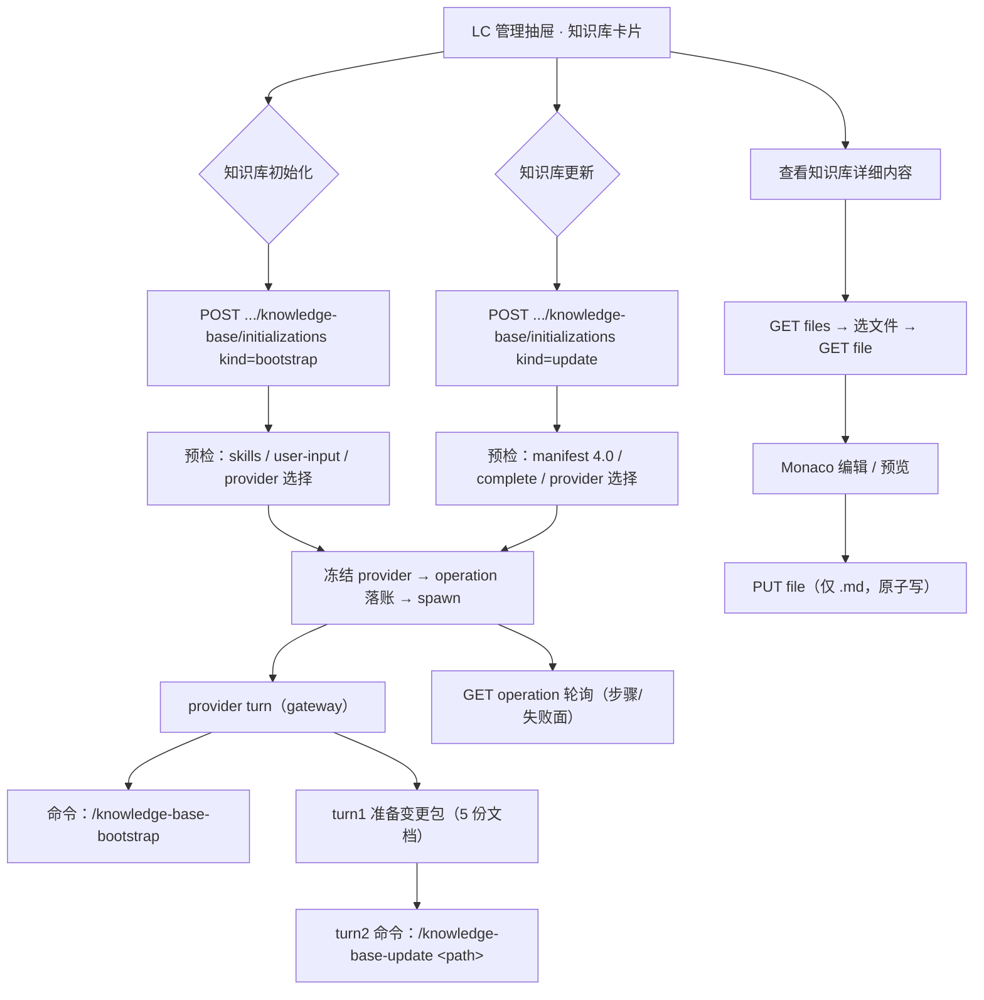

# 技术方案：LC 仓管理 · 知识库模块 v1.0

- 日期：2026-11-09
- 分支：`feat-wig-optimize-11-08`（worktree `.worktrees/feat-wig-optimize-11-08`）
- 状态：待 owner 确认 → 确认后写入 OpenSpec change

---

## 1. 目标

在「LC 仓管理」（逻辑代码库管理抽屉）内增加**知识库模块**，提供三个用户可见能力：

| 能力 | 用户动作 | 落点 |
|---|---|---|
| 知识库初始化 | 按钮 → 调 provider 执行 `/knowledge-base-bootstrap` | 新增 operation（后端） + 卡片按钮（前端） |
| 知识库更新 | 按钮 → 调 provider 执行 `/knowledge-base-update` | 同上 |
| 查看知识库详细内容 | 按钮 → 跳转新地址，渲染当前 LC 下的知识库全部文档，允许编辑与保存 | 新路由 + 新页面 + 文件读写 API |

附带修正：`【聚合初始化准备阶段暂不支持 Kimi Code；该阶段 provider 顺序：Pi > Claude Code > Codex。】` 这行红字贴着上下容器，加内边距。

## 2. 非目标

- 不做知识库的 git 提交/推送（skill 自身也不提交，产物留在聚合根工作区）。
- 不做每个成员仓各自一份知识库（owner 裁决：知识库落在 LC 聚合根一份）。
- 不做知识库与「多仓规划/编码」链路的自动注入（`knowledge-base-context` 的接入属后续独立需求）。
- 不做 Cadence-skills 的安装管理（复用聚合初始化 `machine_skills` 步骤的既有安装链）。
- 不引入新的前端 Markdown 编辑依赖（复用项目已有的 `monaco-editor`）。

## 3. 现状勘察（事实与出处）

### 3.1 聚合初始化（provider 选择的唯一权威）

| 事实 | 出处 |
|---|---|
| 候选顺序冻结为 `[Pi, Claude Code, Codex]`（owner 顺序，无 Kimi） | `src/product/logical_codebase/provider_selection.rs:43-47` |
| 判定与 gateway **同源**：L1 命令可用（health 快照） + L2 能力已核验（`launch_cell_state`） | 同文件 `launch_cell_state` / `decide_selection` |
| 选择器不创建 operation，只给结论（`Selected` / 失败码） | 同文件 `ProviderSelectionOutcome` |
| provider 选择结果冻结进 operation（重试不换人） | `src/product/logical_codebase/coordinator_frozen_provider.inc.rs:3-4` |
| 失败码四枚：`no_provider_available` / `provider_needs_verification` / `provider_capability_denied` / `provider_health_degraded` | `provider_selection.rs:49-61` |

### 3.2 provider 的 skill 调用前缀（唯一来源）

| provider | 前缀 | 出处 |
|---|---|---|
| ClaudeCode | `/` | `src/product/repository_store/types.rs:153-168` |
| Pi | `/skill:` | 同上 |
| Codex | `$cadence-init:` | 同上 |
| KimiCode | `/skill:`（本需求不涉及） | 同上 |

### 3.3 聚合初始化的可复用骨架

| 事实 | 出处 |
|---|---|
| 五步 durable 状态机 + 三个 provider turn（pre_check / rule_and_mcp_config / openspec_and_examples） | `src/product/logical_codebase/aggregate_initialization_coordinator.rs:1-30` |
| provider turn 经 gateway 启动（可审计），命令文本按 provider 前缀生成 | `src/product/logical_codebase/coordinator_provider_turn.inc.rs`、`coordinator_recipe_commands.inc.rs` |
| HTTP 面：`POST/GET/GET active/POST cancel` 四端点 + `GET /api/projects/{pid}/logical-codebases/{lc_id}/...` | `src/web/handlers/aggregate_initialization/handlers.inc.rs`、`src/web/app.rs:134-170` |
| 前端：卡片 `AggregateInitializationCard` + API client + 类型 | `web/src/components/lifecycle/AggregateInitializationCard.tsx`、`web/src/api/aggregate-initialization.ts` |

### 3.4 两个知识库 skill 的硬契约（Cadence-skills）

来源：`/home/michaelche/workspace/github/Cadence-skills/cadence-init/skills/knowledge-base-{bootstrap,update}/SKILL.md`

| 事实 | 影响 |
|---|---|
| bootstrap 的唯一入口是 `cadence/knowledge-base/user-input/base-info.md`，六领域输入文件必须**由人写好**；缺失时 skill 只返回模板与继续入口，不代填 | 「知识库初始化」需要前置预检：输入缺失 → 不启动 provider，直接告诉用户缺哪几份 |
| bootstrap 产物固定落在 `<目标项目根>/cadence/knowledge-base/`（`manifest.yaml`、`input-inventory.md`、`README.md`、`base-information.md`、`development-guide.md`、`interfaces/`、`pages/`、`services/`、`data-models/`、`configurations/`、`evidence/`、`business/`、`capabilities/`、`domain-glossary.md`、`open-questions.md`、`change-history.md`） | 知识库根目录 = LC 聚合根下的 `cadence/knowledge-base/` |
| update 只接受 `schema_version: "4.0"` 且 `coverage.initialization.status == complete` 的 Manifest；否则立即停止 | 「知识库更新」按钮在未完成初始化时禁用并说明原因 |
| update 必须**显式指定唯一变更包目录** `cadence/knowledge-base/user-input/updates/CHANGE-<标识>/`，且**禁止扫描 updates/ 自动挑最新** | 变更包路径必须由平台显式给出 |
| 变更包固定 5 份文档（`change-summary.md` / `code-change.md` / `database-change.md` / `configuration-change.md` / `verification.md`），插件里那份 `user-input/change-package/` 是**模板** | 变更包是 skill 的**输入**，由调用方（agent）准备，不是 skill 的产物 |
| 「变更完成后必须由用户显式指定唯一变更标识，准备完整变更包，再由 `knowledge-base-update` 消费后执行 Update」（`knowledge-base-overview/SKILL.md:68`、`:206`） | 平台「一键更新」= 平台代表用户指定唯一变更标识 → provider 依据本地 Git 事实把 5 份文档填好 → 再以显式路径调 skill。与 Cadence-skills 原设计一致 |
| 敏感信息硬约束：真实配置值一律 `<redacted>`；不得保存敏感值哈希 | 变更包准备 prompt 必须带上这条；平台不做值级脱敏（由 skill 门禁负责） |

### 3.5 前端既有能力与缺口

| 事实 | 出处 |
|---|---|
| `monaco-editor` + `@monaco-editor/react` **已是依赖**，且有本地化 loader（无 CDN） | `web/package.json:15,20`、`web/src/components/shared/monaco-local-setup.ts` |
| 既有 `MonacoViewer` / `MonacoDiffViewer` **写死 `readOnly: true`** | `web/src/components/shared/MonacoViewer.tsx:34`、`MonacoDiffViewer.tsx:37` |
| 既有 `MarkdownContent`（`marked` lexer 手工渲染，安全链接白名单）但**内嵌在聊天条目里，非公共组件** | `web/src/components/chat-workspace/entries/ProviderStreamEntry.tsx:684` |
| **没有任何可写 Markdown 编辑器**、没有文件树、没有预览/编辑双栏 | 全仓 grep 结论 |
| **没有任何 HTTP 文件写入端点**；`/api/files/content` 只读且前端 0 引用 | `src/web/app.rs:612-616`、`src/web/handlers/runtime.rs:294-324` |
| 路由用 TanStack Router v1，实体路由挂在 `/workbench` 下，参数段用 `$param` | `web/src/router.tsx:129-273` |
| 「LC 仓管理」不在路由里，是 `/workbench` 内的一个右侧抽屉 | `web/src/components/lifecycle/IssueLifecycleWorkbenchView.tsx:158-160` |
| 那行红字在两处出现：`ProviderManagementPanel.tsx:21-24`（**无内边距，贴边**）与 `AggregateInitializationCard.tsx:320-323`（已有 `px-2 py-1` + 边框） | 同左 |

## 4. owner 已裁决的设计决策

| # | 决策 | 裁决内容 |
|---|---|---|
| D1 | provider 语义 | **复用聚合初始化的 provider 选择器**（候选序 Pi > Claude Code > Codex，同一套 L1/L2 判据），选中**一家**由它执行知识库 skill。不做「三家各跑一次」 |
| D2 | 知识库落地位置 | **LC 聚合根** `<aggregate_root>/cadence/knowledge-base/`，一份；成员仓是被分析对象 |
| D3 | 变更包 | **平台一键生成**：平台指定唯一变更标识 → provider 依据本地 Git 事实把 5 份文档补全 → 再以显式路径调 `/knowledge-base-update` |
| D4 | 编辑器 | **把项目已有的 Monaco 扩成可写变体**（零新依赖），配 Markdown 预览双栏 |

## 5. 方案

### 5.1 后端：知识库 operation（新模块，不动聚合初始化的冻结配方）

**为什么不复用聚合初始化的 coordinator**：它的五步与四条 root recipe 命令是冻结契约（`root_recipe_command_index()` 被测试锁死），塞进知识库步骤会破坏既有断言与审计窗口。知识库另起一套 operation，复用**选择器 / gateway / trust 门 / 取消语义**。

新增模块 `src/product/logical_codebase/knowledge_base/`：

```
knowledge_base/
├── mod.rs                 # 模块导出
├── operation.rs           # KnowledgeBaseOperation / 状态 / 步骤 / 错误记录
├── store.rs               # durable store（JSON，落 .aria/projects/<pid>/logical-codebase/knowledge-base-operations/）
├── command.rs             # provider → skill 命令文本（唯一前缀来源）
├── coordinator.rs         # 状态机：预检 → provider turn → 完成/失败
├── prompts.rs             # 变更包准备 prompt、scope 纪律段
└── files.rs               # KB 文件树 / 读 / 写（路径授权）
```

**operation 形状**（复用 `AggregateProviderSelection` 与 `AggregateInitializationErrorRecord` 形态，不另造失败面词汇）：

```text
KnowledgeBaseOperation {
  operation_id, project_id, logical_codebase_id,
  kind: bootstrap | update,
  input: { idempotency_key, provider, package_path?(update), package_id?(update) },
  status: running | completed | failed | cancelled,
  steps: [ { step_id, status, started_at, completed_at, output_summary } ],
  provider_selection: AggregateProviderSelection,
  error: Option<...>,
  created_at / started_at / completed_at
}
```

步骤：

| kind | 步骤 | 性质 |
|---|---|---|
| bootstrap | `bootstrap` | 1 个 provider turn，命令 = 前缀 + `knowledge-base-bootstrap` |
| update | `prepare_change_package` → `apply_update` | 2 个 provider turn：前者填 5 份变更包文档（prompt 生成，非 skill 调用）；后者命令 = 前缀 + `knowledge-base-update <变更包路径>` |

**命令文本唯一来源**：`command.rs` 复用 `RepositoryInitializationStepKind::skill_command_prefix(provider)` 取前缀，不另写一份 provider→前缀映射；命令名固定 `knowledge-base-bootstrap` / `knowledge-base-update`。

**provider turn 执行**：复用 gateway 启动路径（与聚合初始化同一 `start_streaming` 通道与 `GatewayRunAudit` 记账），cwd = canonical 聚合根；取消 / 超时 / 输出摘要语义与 `coordinator_provider_turn.inc.rs` 一致。

#### 复用的既有件（逐项点名，避免实施时重新发明）

| 既有件 | 出处 | 知识库侧怎么用 |
|---|---|---|
| `select_aggregate_provider` | `provider_selection.rs` | 创建期选 provider，候选序/判据/失败码原样 |
| `AggregateProviderSelection` + `provider_selection_api_error` | `provider_selection.rs`、`handlers.inc.rs:784` | 冻结选择结果 + 失败面 details（候选表/核验入口）原样复用 |
| `RepositoryInitializationStepKind::skill_command_prefix` | `repository_store/types.rs:153-168` | skill 前缀唯一来源（不另写映射表） |
| gateway `SessionLaunchRequest` / `PolicyTarget::aggregate_root` | `coordinator_provider_turn.inc.rs:93-110` | 同样的 envelope 形状：action=`PlanningReadOnly`、target=聚合根、cwd=聚合根、`readable_roots=[根]`、`config_artifact_ref` 同款 |
| `StreamingProviderInput` 组装 | 同上 `:158-200` | provider_type 四家映射、`role=Executor`、`permission_mode=Auto`、超时 1800s 同款；只换 prompt |
| `BootstrapExecutorMarker`（写权限承载） | `provider_admission_credential.inc.rs:244-300` | KB turn 同样走「有写权限的 Executor」通道；`receipt_context` 换成 `knowledge-base:{operation_id}:{step}`（root recipe 用的是固定命令索引，KB 没有那张表） |
| `ProviderTrustPrecondition::ensure_ready(..., ProviderTrustScenario::Recipe)` | `handlers.inc.rs:707-748` | 创建期 trust 前置门，等待面沿用 `aggregate_initialization_trust_waiting` 口径 |
| `InitializationRunRegistry` / `InitializationRunKey` | `web/state/repository_initialization_run_registry.rs:14-68` | 新增 `InitializationOperationKind::KnowledgeBase` 变体 + `InitializationRunKey::knowledge_base(...)`，同一 LC 同一时刻只允许一个知识库 operation 在跑 |

#### 必须解耦的一处（实施风险最高点）

`BootstrapPhaseCredential::from_running_operation`（`provider_admission_credential.inc.rs:76-112`）与
`reverify_against_running_operation`（同文件 `:118-160`）**硬耦合** `AggregateInitializationOperationStore`
与 `AggregateInitializationStepKind`：凭据的「durable Running 重核验」通道只认聚合初始化的 operation。

因此知识库 turn 若照抄，会在 gateway 的 `require_root_recipe_supported`（`provider_gateway.rs:978-983`，
经 `production_policy_resolvers.rs:356-393`）处拿不到可重验的 durable Running 事实 → 直接 fail-closed 拒绝，
provider 零启动。

**处置（设计决策）**：把「自举相位事实」抽成参数化的一层——
派生与重核验接受同一组事实（project_id / lc_id / operation_id / step_id / input_digest / canonical_root /
是否 Running），聚合初始化与知识库各提供一份事实来源；
**凭据结构体、admission 相位（`ProviderAdmissionPhase::AggregateBootstrap`）、capability 取
`PlanningReadOnly` 行、route policy 与 cwd authority 校验全部不变**。
聚合初始化既有调用点语义零变化（回归由既有测试锁定），知识库走同一相位与同一 capability 口径。

#### 写入面审计

root recipe 有「命令前后快照 + 允许写入面」的审计窗口（`web/handlers/aggregate_initialization/root_recipe_audit_windows.inc.rs`）。
知识库 turn 同样记录写入面差分：允许面 = `<聚合根>/cadence/knowledge-base/**`；
越界写入 → operation 失败并标 `knowledge_base_write_scope_violation`（与仓库 fail-closed 惯例一致）。

**创建期预检（不启动 provider，失败即返回，不产生 operation）**：

| kind | 预检项 | 失败面 |
|---|---|---|
| bootstrap | ① Cadence-skills 已安装且含 `knowledge-base-bootstrap` | `knowledge_base_skills_unavailable` |
| bootstrap | ② `<root>/cadence/knowledge-base/user-input/` 六领域输入齐全（`base-info.md` 必填；`project-scope.md`/`data-model-scope.md`/`configuration-scope.md`/`middleware-scope.md`/`api-scope.md`/`page-scope.md`） | `knowledge_base_inputs_incomplete`（details 列出缺失文件与模板路径） |
| update | ① `manifest.yaml` 存在且 `schema_version == "4.0"` | `knowledge_base_manifest_missing` / `knowledge_base_manifest_version_unsupported` |
| update | ② `coverage.initialization.status == complete`（且 `global_validation == passed`） | `knowledge_base_not_initialized` |
| 两者 | ③ provider 选择（同聚合初始化选择器；四枚失败码原样透出） | 复用 `aggregate_initialization_*` 四码 |

#### 知识库更新的两段 turn（细节）

**turn 1 `prepare_change_package`**（不是 skill 调用，是平台生成的 prompt）：

| prompt 要素 | 内容 |
|---|---|
| 唯一变更标识 | `CHANGE-<YYYYMMDD-HHMMSS>`（平台生成，随 operation 冻结，重试不换包） |
| 唯一合法目录 | `<聚合根>/cadence/knowledge-base/user-input/updates/CHANGE-<标识>/`（prompt 内逐字给出绝对路径） |
| 模板来源 | 插件内 `cadence-init/skills/knowledge-base-update/user-input/change-package/` 的 5 份文档 |
| 事实来源 | 起始提交 = Manifest `git.repositories` 里记录的基线（若有）；结束提交 = 成员仓当前 HEAD；一律要求用 `git diff <base>..<head>` 核对后再填 |
| 硬口径 | 不得编造 MR/分支/提交号；无法解析的字段写「不适用（具体原因）」；敏感值一律 `<redacted>`；只写该目录下的 5 个 `.md`，不碰知识库其它文件 |
| 产出 | 该目录下 5 份文档（`change-summary.md` / `code-change.md` / `database-change.md` / `configuration-change.md` / `verification.md`） |

**turn 2 `apply_update`**：命令 = provider 前缀 + `knowledge-base-update <turn 1 的变更包绝对路径>`，
后附与 root recipe 同款的 scope 纪律段（聚合根绝对路径硬钉 + 成员仓负边界 + 越界写即被审计拒绝）。

**幂等**：变更包路径随 operation 冻结；skill 侧按 `update.processed_packages` 判重（相同变更标识 + 相同幂等标识 → 已处理，不重复写）。

**失败即停**：turn 1 或 turn 2 失败 → operation 失败并落 durable 失败事实，**不改任何知识库文档**
（skill 自身也是「门禁不过 → 停止且零修改」）。

> 预检只判断「输入是否具备」，不代替 skill 自己的门禁；skill 判定为损坏/不适用时，失败面按 skill 输出原文呈现。

**预检①的具体判定（skills 可用性）**：Cadence-skills 安装器把 `cadence-init/skills/*` 全量软链到三层根
（`src/product/cadence_skills/link_sync.rs:47-93`），所以「装了就都有」。判定按**被选中的 provider**取对应层：

| provider | skill 链接层 | 判定路径（`CadenceSkillsPaths`，`paths.rs:11-55`） |
|---|---|---|
| ClaudeCode | claude 层 | `~/.claude/skills/knowledge-base-bootstrap/SKILL.md` |
| Pi | shared 层 | `~/.agents/skills/knowledge-base-bootstrap/SKILL.md` |
| Codex | codex 层 | `~/.codex/skills/skills/knowledge-base-bootstrap/SKILL.md` |

源根 `~/.agents/Cadence-skills/cadence-init/skills/knowledge-base-bootstrap/SKILL.md` 不存在 → 说明 Cadence-skills 未安装或版本过旧
→ 失败面 `knowledge_base_skills_unavailable`，details 给出「先在 Provider 管理里安装/更新 Cadence-skills」的入口文案
（**不自动安装**：安装链属聚合初始化的 `machine_skills` 步骤，本模块不越权代劳）。

### 5.2 后端：HTTP 面

| 方法 | 路径 | 语义 |
|---|---|---|
| POST | `/api/projects/{pid}/logical-codebases/{lc_id}/knowledge-base/initializations` | 创建 operation（bootstrap 或 update，带 `kind`）；预检 → 冻结 provider → spawn |
| GET | `.../knowledge-base/initializations/active` | 当前 LC 最新 operation 投影（含终态） |
| GET | `.../knowledge-base/initializations/{operation_id}` | 单次 operation 投影（纯投影，不启动 provider） |
| POST | `.../knowledge-base/initializations/{operation_id}/cancel` | 取消（沿用聚合初始化的取消语义） |
| GET | `.../knowledge-base/files` | KB 目录树（相对路径 + 字节数 + 可编辑标记） |
| GET | `.../knowledge-base/file?path=<相对路径>` | 读单个文件 |
| PUT | `.../knowledge-base/file` | 写单个文件（body: `{path, content}`） |

**路径授权（写侧最敏感，逐条锁死）**：

1. 根 = `canonicalize(<LC 聚合根>)` + `cadence/knowledge-base`；所有路径必须是**相对路径**。
2. 解析后 `canonicalize`（跟随符号链接）再判定必须仍在根内 → 禁 `..`、绝对路径、符号链接逃逸。
3. 读：常规文件，大小上限 1 MiB。
4. 写：**仅 `*.md`**（`manifest.yaml`、`evidence/relation-graph.yaml` 等机器管理/派生文件天然不可写）；允许在 `user-input/` 下新建 `.md`（这是人准备输入与变更包的正规路径）；原子写（临时文件 + rename）。
5. 并发：写请求可携带读时拿到的 `base_digest`；服务端当前 digest 与之不符 → `409 knowledge_base_file_conflict`（不静默覆盖）。不带 `base_digest` 时按「直接覆盖」处理（单人编辑场景）。
6. 不允许删除文件（本次不提供删除面）。
7. 同一路径同时只允许一个写（按路径加锁，进程内即可）。

### 5.3 前端：LC 管理抽屉内的「知识库」卡片

新增 `web/src/components/lifecycle/KnowledgeBaseCard.tsx`（与 `AggregateInitializationCard` 同构：卡片头 + 按钮区 + 步骤列表 + 失败面文案）：

- 按钮：**知识库初始化** / **知识库更新** / **查看知识库详细内容**
- 「知识库更新」在 KB 未 complete 时禁用，禁用原因写在按钮下方一行（不是 tooltip）
- 「查看知识库详细内容」跳转新路由
- 两个执行类按钮点下去先弹**二次确认**（会真实调用 provider、消耗额度、写入聚合根目录），确认文案写明这两件事
- 卡片同时展示：本次使用的 provider + 跳过原因摘要（复用 `AggregateInitializationCard` 的 provider 摘要组件口径）、当前步骤与失败原因

### 5.4 前端：知识库详情页

- 路由：`/workbench/projects/$projectId/logical-codebases/$lcId/knowledge-base`（挂 `guardedWorkflowRoute` 下，与既有实体路由同风格）
- 页面 `web/src/pages/KnowledgeBasePage.tsx`：
  - 左：KB 文件树（目录分组，只读展开/收起）
  - 右：页签「编辑 / 预览」；编辑 = Monaco 可写；预览 = Markdown 渲染
  - 底部/头部：保存按钮（PUT），有未保存改动时离开页面给提示
- 新增/改动的前端件：
  - `web/src/components/shared/MonacoEditor.tsx`：**可写** Monaco（复用 `monaco-local-setup.ts` 与 `useSystemMonacoTheme`，与 `MonacoViewer` 同源不同写权限）
  - `web/src/components/shared/MarkdownContent.tsx`：把 `ProviderStreamEntry.tsx:684` 的 `MarkdownContent` **提取为公共组件**（原处改为 import，行为不变）
  - `web/src/api/knowledge-base.ts` + `web/src/api/types/knowledge-base.ts`

### 5.5 附带修正：provider 顺序红字内边距

`web/src/components/lifecycle/ProviderManagementPanel.tsx:21-24` 的 notice 加与 `AggregateInitializationCard.tsx:320-323` 一致的容器样式（`rounded border border-[var(--aria-danger)] bg-[var(--aria-danger-soft)] px-2 py-1`），两处视觉统一；文案与 testid 不变。

## 6. 数据流



## 7. 验收口径（UI 验收矩阵）

| 场景 | 期望界面行为 |
|---|---|
| LC 无成员仓 | 知识库卡片不渲染（与聚合初始化卡同一前置条件） |
| 未做聚合初始化（Cadence-skills 未装） | 点「知识库初始化」→ 失败面「知识库 skills 不可用」，不产生 operation |
| `user-input/` 缺领域输入 | 点「知识库初始化」→ 失败面列出缺失文件 + 模板路径，不启动 provider |
| provider 全未核验 | 点任一执行按钮 → 失败面复用 `aggregate_initialization_provider_needs_verification`（含「去核验 X」入口口径） |
| 初始化进行中 | 卡片显示步骤列表 + 「取消」；重复点击不启动第二次 |
| 初始化完成 | 卡片显示完成态 + 「查看知识库详细内容」可用 |
| KB 未 complete 时点「知识库更新」 | 按钮禁用 + 下方一行说明「需先完成知识库初始化」 |
| 点「查看知识库详细内容」 | 跳到 `/workbench/projects/<pid>/logical-codebases/<lc>/knowledge-base`，左树右编辑 |
| 编辑 `.md` 保存 | 内容落盘（`manifest.yaml` / `relation-graph.yaml` 不可编辑，UI 不给编辑入口） |
| 编辑 `manifest.yaml` | 详情页只读（提示「机器管理文件，不可编辑」） |

## 8. 风险与已知缺口

| 风险 | 影响 | 处置 |
|---|---|---|
| 两个知识库 skill 面向 **Java + Vue/React** 存量项目；LC 成员仓若为其它技术栈，skill 会按自身契约判定 | 初始化可能以「范围/证据不足」失败 | 平台**不做技术栈拦截**（不猜），失败面透传 skill 原文；UI 提示语写「知识库 skill 面向 Java/Vue/React 存量项目」 |
| bootstrap 需要人写六领域输入 | 按钮点了没反应感强 | 预检在**启动 provider 前**拦下并列出缺哪几份；详情页提供输入文件编辑入口 |
| update 变更包由 provider 依据 Git 事实填写，可能填错 | skill 门禁拦截 → 停止，不污染知识库 | 失败面透传 skill 原文；变更包 5 份文档在详情页可见可改 |
| Codex 前缀 `$cadence-init:` 依赖插件安装到位 | Codex 被选中但命令跑不起来 | 预检①（skills 已安装）覆盖；失败面说明 |
| 单次 provider turn 可能十几分钟 | 用户以为卡死 | 卡片显示步骤进行中 + 可取消；二次确认文案写明耗时与额度消耗 |
| 聚合根写入无 git 保护 | 误写风险 | skill 自身有「显式重新初始化需二次授权」门禁；平台不做 git 回滚 |

## 9. 后续（不在本批）

- `knowledge-base-context` 接入多仓规划/编码链路（让 agent 自动读 KB）。
- 知识库产物的 git 提交/发布策略。
- KB 文档的全文检索。
