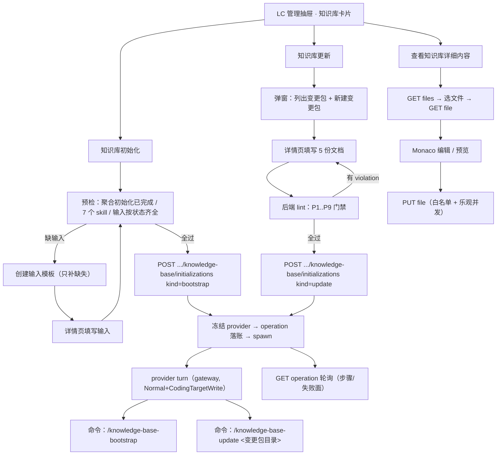

# 技术方案：LC 仓管理 · 知识库模块 v1.2

- 日期：2026-11-09
- 分支：`feat-wig-optimize-11-08`（worktree `.worktrees/feat-wig-optimize-11-08`）
- 状态：待 owner 确认 → 确认后写入 OpenSpec change
- 演进：
  - v1.0 初版；
  - v1.1 **变更包由用户填写**（owner 2026-11-09 纠正：平台只提供模板 + 卡门禁，不由 provider 代写）；
  - v1.2 落 **builder check（接地审查）** 的 11 条修正：写权限通道改 Normal 相位 + `CodingTargetWrite`、skills 判定名单改 7 个、输入齐全口径按 `input-contract`、新增 KB status 端点、预检失败面独立化、新码登记、store 落 `lc_scope_root`、per-LC 全局单飞、写侧白名单扩 `.sql` + 乐观并发、provider 摘要组件公共化。

---

## 1. 目标

在「LC 仓管理」（逻辑代码库管理抽屉）内增加**知识库模块**，提供三个用户可见能力：

| 能力 | 用户动作 | 落点 |
|---|---|---|
| 知识库初始化 | 按钮 → 调 provider 执行 `/knowledge-base-bootstrap` | 新增 operation（后端） + 卡片按钮（前端） |
| 知识库更新 | 按钮 → 调 provider 执行 `/knowledge-base-update` | 同上 |
| 查看知识库详细内容 | 按钮 → 跳转新地址，渲染当前 LC 下的知识库全部文档，允许编辑与保存 | 新路由 + 新页面 + 文件读写 API |

附带修正：`【聚合初始化准备阶段暂不支持 Kimi Code；该阶段 provider 顺序：Pi > Claude Code > Codex。】` 这行红字贴着上下容器，加内边距。

## 2. 非目标

- 不做知识库的 git 提交/推送（skill 自身也不提交，产物留在聚合根工作区）。
- 不做每个成员仓各自一份知识库（owner 裁决：知识库落在 LC 聚合根一份）。
- 不做知识库与「多仓规划/编码」链路的自动注入（`knowledge-base-context` 的接入属后续独立需求）。
- 不做 Cadence-skills 的安装管理（复用聚合初始化 `machine_skills` 步骤的既有安装链）。
- 不引入新的前端 Markdown 编辑依赖（复用项目已有的 `monaco-editor`）。
- **不由 provider 代写用户的输入**：六领域输入、变更包 5 份文档，一律由用户在网页里填写。

## 3. 现状勘察（事实与出处）

### 3.1 聚合初始化（provider 选择的唯一权威）

| 事实 | 出处 |
|---|---|
| 候选顺序冻结为 `[Pi, Claude Code, Codex]`（owner 顺序，无 Kimi） | `src/product/logical_codebase/provider_selection.rs:43-47` |
| 判定与 gateway **同源**：L1 命令可用（health 快照） + L2 能力已核验（`launch_cell_state`） | 同文件 `launch_cell_state` / `decide_selection` |
| 选择器不创建 operation，只给结论（`Selected` / 失败码） | 同文件 `ProviderSelectionOutcome` |
| provider 选择结果冻结进 operation（重试不换人） | `src/product/logical_codebase/coordinator_frozen_provider.inc.rs:3-4` |
| 失败码四枚：`no_provider_available` / `provider_needs_verification` / `provider_capability_denied` / `provider_health_degraded` | `provider_selection.rs:49-61` |
| **一次「核验」同时确认三个 action 分格**（`CodingTargetWrite` / `PlanningReadOnly` / `ReviewReadOnly`） | `src/product/logical_codebase/provider_capability_revalidate.rs:40-43`（`REVALIDATE_ACTIONS`） |
| capability 记录按 action 分行存（`action_matrix`），缺行视为未探测 | `provider_capability_store.rs:156-167`、`:186-192` |
| 聚合根 target 只 canonicalize，**不要求 git 身份**（git 身份复验只作用于 checkout 分支） | `production_policy_resolvers.rs:163-169` vs `:153` |

### 3.2 provider 的 skill 调用前缀（唯一来源）

| provider | 前缀 | 出处 |
|---|---|---|
| ClaudeCode | `/` | `src/product/repository_store/types.rs:153-168` |
| Pi | `/skill:` | 同上 |
| Codex | `$cadence-init:` | 同上 |

> 上游 Cadence-skills 文档对 Codex 调用形态表述不一（`readmes/skills/knowledge-base-bootstrap.md:64` 写「不使用插件命名空间」，
> `agents/openai.yaml` 写 `$knowledge-base-bootstrap`）。**本方案钉死沿用仓库既有契约 `skill_command_prefix`**
> （与已在生产运行的四条 recipe 命令 `/pre-check`、`/rule-config`、`/mcp-configuration`、`/project-rules-examples` 完全一致），
> Codex 走 `$cadence-init:`。若真机验证发现 Codex 侧不认该形态，**只改 `skill_command_prefix` 一处映射**即可（单一来源）。

### 3.3 聚合初始化的可复用骨架

| 事实 | 出处 |
|---|---|
| 五步 durable 状态机 + 三个 provider turn | `src/product/logical_codebase/aggregate_initialization_coordinator.rs:1-30` |
| provider turn 经 gateway 启动（可审计），命令文本按 provider 前缀生成 | `coordinator_provider_turn.inc.rs`、`coordinator_recipe_commands.inc.rs` |
| HTTP 面四端点（create / active / get / cancel） | `src/web/handlers/aggregate_initialization/handlers.inc.rs`、`src/web/app.rs:134-170` |
| 前端卡片 + API client + 类型 | `web/src/components/lifecycle/AggregateInitializationCard.tsx`、`web/src/api/aggregate-initialization.ts` |
| operation 落盘按 `lc_scope_root`（per-LC 目录，legacy 别名由该 helper 处理） | `aggregate_initialization_store_operations.inc.rs:22` |
| 运行登记键 `InitializationRunKey{kind, project_id, lc_id, operation_id}`；`kind` 现只有 `Repository`/`Aggregate` | `web/state/repository_initialization_run_registry.rs:14-68` |
| durable 层已有「同 LC 已有别的初始化在跑 ⇒ 拒绝」先例（`other_recipe_running`） | `src/web/handlers/aggregate_initialization/handlers.inc.rs:307-324` |

### 3.4 两个知识库 skill 的硬契约（Cadence-skills）

来源：`/home/michaelche/workspace/github/Cadence-skills/cadence-init/skills/knowledge-base-{bootstrap,update}/SKILL.md`

| 事实 | 影响 |
|---|---|
| bootstrap 的唯一入口是 `cadence/knowledge-base/user-input/base-info.md`；六领域输入文件**必须由人写好**；缺失时 skill 只返回模板与继续入口，不代填 | 「知识库初始化」需要前置检查 + **模板创建**入口；内容由用户在网页里写 |
| bootstrap 插件自带输入模板 9 份（`user-input/`：`base-info.md`、`project-scope.md`、`data-model-scope.md`、`configuration-scope.md`、`middleware-scope.md`、`api-scope.md`、`page-scope.md`、`database-ddl.sql`、`product.md`），模板首行原文：「请将整套模板复制到目标项目的 `cadence/knowledge-base/user-input/` 后填写」 | 平台「创建输入模板」= 从插件源目录整份复制 |
| scope 文件按**领域状态条件必需**：状态「不适用」时不要求该引用文件可用；`product.md` / `database-ddl.sql` 明确可选 | 平台「输入齐全」判定必须**按 base-info.md 里声明的状态**条件判定，不能一律当必填（否则合法的不适用项目被误判） |
| bootstrap 会 REQUIRED 调用 `knowledge-base-base-info` / `-api` / `-pages` / `-overview`，overview 之前还要 `knowledge-base-context`；加上 `-bootstrap` / `-update` 共 **7 个** skill | skills 可用性判定名单 = 全部 7 个 `knowledge-base-*`（缺任一 → 运行期才炸） |
| bootstrap 产物固定落在 `<目标项目根>/cadence/knowledge-base/` | 知识库根目录 = LC 聚合根下的 `cadence/knowledge-base/` |
| update 只接受 `schema_version == "4.0"` 且 `coverage.initialization.status == complete` 的 Manifest；否则立即停止且零修改 | 「知识库更新」按钮在未完成初始化时禁用并说明原因 |
| update 必须**显式指定唯一变更包目录** `cadence/knowledge-base/user-input/updates/CHANGE-<标识>/`，且**禁止扫描 updates/ 自动挑最新** | 变更包路径必须由用户显式给出（选一个已存在的，或新建一个） |
| 变更包固定 5 份文档 + 可选 `attachments/`；插件里 `user-input/change-package/` 是**模板** | 平台「新建变更包」= 从插件源目录复制模板骨架；**内容由用户填写** |
| 变更包门禁（skill `:54-108`）：Manifest 门禁 / 变更包完整性门禁（存在、可读、字段非空、不适用须写「不适用（具体原因）」、敏感信息门禁、七行领域矩阵）/ 代码变更门禁（MR、源/目标分支、起止提交可解析、修改范围）/ 数据库与配置门禁（双快照、指纹、范围摘要） | 平台在启动 provider **之前**卡住**可机械判定**的那部分（见 §5.3），其余交回 skill 门禁 |
| 敏感信息硬约束：真实配置值一律 `<redacted>`；不得保存敏感值哈希 | 平台门禁做保守扫描，命中即拦 |
| overview 阶段还会写 `cadence/project-rules/knowledge-base-usage.md` 与聚合根 `CLAUDE.md` / `AGENTS.md` 的稳定管理区块 | provider 写面不止 `cadence/knowledge-base/**`；写入面审计的允许清单必须包含这些路径 |
| 「变更完成后必须由用户显式指定唯一变更标识，准备完整变更包，再由 `knowledge-base-update` 消费后执行 Update」（`knowledge-base-overview/SKILL.md:68`、`:206`） | 与本方案一致：用户指定标识 → 准备变更包 → 平台调 skill |

### 3.5 前端既有能力与缺口

| 事实 | 出处 |
|---|---|
| `monaco-editor` + `@monaco-editor/react` **已是依赖**，且有本地化 loader（无 CDN） | `web/package.json:15,20`、`web/src/components/shared/monaco-local-setup.ts` |
| 既有 `MonacoViewer` / `MonacoDiffViewer` **写死 `readOnly: true`** | `web/src/components/shared/MonacoViewer.tsx:34`、`MonacoDiffViewer.tsx:37` |
| 既有 `MarkdownContent`（`marked` lexer 手工渲染 + 安全链接白名单）内嵌在聊天条目里，**非公共组件**（连带 14 个模块私有函数） | `web/src/components/chat-workspace/entries/ProviderStreamEntry.tsx:106-541`、`:684` |
| **没有任何可写 Markdown 编辑器**、没有文件树、没有共享 Tabs（6 处各自手写） | 全仓 grep 结论 |
| **没有任何 HTTP 文件写入端点**；`/api/files/content` 只读且前端 0 引用 | `src/web/app.rs:612-616`、`src/web/handlers/runtime.rs:294-324` |
| 前端**无 YAML 解析依赖** | `web/package.json`（只有 `marked` / `monaco-editor` / `lucide-react`） |
| 路由用 TanStack Router v1，实体路由挂在 `/workbench` 下，参数段用 `$param` | `web/src/router.tsx:129-273` |
| 「LC 仓管理」不在路由里，是 `/workbench` 内的一个右侧抽屉 | `web/src/components/lifecycle/IssueLifecycleWorkbenchView.tsx:158-160` |
| 二次确认沿用原生 `window.confirm`（lifecycle 域既有惯例）；未保存提示有 `hooks/useUnloadGuard.ts` | `AggregateInitializationCard.tsx:236`、`web/src/hooks/useUnloadGuard.ts` |
| 那行红字在两处出现：`ProviderManagementPanel.tsx:21-24`（**无内边距，贴边**）与 `AggregateInitializationCard.tsx:320-323`（已有 `px-2 py-1` + 边框） | 同左 |
| Cadence-skills 安装器把 `cadence-init/skills/*` 全量软链到三层根（shared `~/.agents/skills`、codex `~/.codex/skills/skills`、claude `~/.claude/skills`） | `src/product/cadence_skills/link_sync.rs:47-93`、`paths.rs:11-55` |
| 失败文案单一来源是 `failure_copy_table.inc.rs`；HTTP status 映射在 `src/web/error.rs`（未登记的码默认 500） | `src/product/logical_codebase/failure_copy_table.inc.rs`、`src/web/error.rs` |

## 4. owner 已裁决的设计决策

| # | 决策 | 裁决内容 |
|---|---|---|
| D1 | provider 语义 | **复用聚合初始化的 provider 选择器**（候选序 Pi > Claude Code > Codex，同一套 L1/L2 判据），选中**一家**由它执行知识库 skill |
| D2 | 知识库落地位置 | **LC 聚合根** `<aggregate_root>/cadence/knowledge-base/`，一份；成员仓是被分析对象 |
| D3 | 变更包来源 | **用户填写**：平台只提供模板骨架 + 门禁校验 + 显式路径调用 skill；**不由 provider 代写** |
| D4 | 编辑器 | **把项目已有的 Monaco 扩成可写变体**（零新依赖），配 Markdown 预览双栏 |

**本方案自定的实施级决策**（按仓内惯例定，不需 owner 裁决）：

| # | 决策 | 内容与理由 |
|---|---|---|
| D5 | provider turn 的写权限通道 | **Normal 相位 + `SessionPolicyAction::CodingTargetWrite`（target = canonical 聚合根）**（见 §5.2 的三条候选对比） |
| D6 | 知识库操作的前置条件 | **聚合初始化已完成**（根规则 + 已发布政策 + Cadence-skills 已装）——Normal 相位本来就要求「根规则必须存在」，且 skill 安装也来自聚合初始化 |
| D7 | 命令参数形态 | update 命令传**变更包目录路径**（相对聚合根），三家统一；不传变更标识 |
| D8 | 单飞语义 | **per-LC 全局单飞**：bootstrap 与 update 互斥，同 LC 任一 KB operation Running 即拒绝新启 |

## 5. 方案

### 5.1 后端：知识库 operation（新模块，不动聚合初始化的冻结配方）

**为什么不复用聚合初始化的 coordinator**：它的五步与四条 root recipe 命令是冻结契约（`root_recipe_command_index()` 被测试锁死），
塞进知识库步骤会破坏既有断言与审计窗口。知识库另起一套 operation，复用**选择器 / gateway / trust 门 / 取消语义 / 单飞登记**。

新增模块 `src/product/logical_codebase/knowledge_base/`：

```
knowledge_base/
├── mod.rs                 # 模块导出
├── operation.rs           # KnowledgeBaseOperation / 状态 / 步骤 / 错误记录
├── store.rs               # durable store（落 lc_scope_root/knowledge-base-operations/）
├── command.rs             # provider → skill 命令文本（唯一前缀来源）
├── coordinator.rs         # 状态机：预检 → provider turn → 完成/失败
├── templates.rs           # 模板骨架创建（bootstrap 输入模板 / update 变更包模板）
├── change_package.rs      # 变更包门禁（字段清单 + 占位判定 + 敏感信息扫描 + 提交可解析校验）
├── manifest.rs            # manifest.yaml 解析（YAML 在 Rust 侧解析，投影结构化 DTO）
└── files.rs               # KB 文件树 / 读 / 写（路径授权）
```

**operation 形状**（复用 `AggregateProviderSelection` 与 `AggregateInitializationErrorRecord` 形态，不另造失败面词汇）：

```text
KnowledgeBaseOperation {
  operation_id, project_id, logical_codebase_id,
  kind: bootstrap | update,
  input: { idempotency_key, provider, package_path?(update), package_id?(update) },
  status: running | completed | failed | cancelled,
  steps: [ { step_id, status, started_at, completed_at, output_summary } ],
  provider_selection: AggregateProviderSelection,
  error: Option<...>,
  created_at / started_at / completed_at
}
```

**落盘位置**：`lc_scope_root(paths, project_id, lc_id)/knowledge-base-operations/`
（与聚合初始化同款 per-LC 目录约定；`operation_id` 派生**含 lc_id**，避免两个 LC 传同一 `idempotency_key` 撞 id）。

步骤与命令：

| kind | 步骤 | 命令文本 |
|---|---|---|
| bootstrap | `bootstrap` | provider 前缀 + `knowledge-base-bootstrap` |
| update | `apply_update` | provider 前缀 + `knowledge-base-update <变更包目录（相对聚合根）>` |

**命令前缀唯一来源**：`command.rs` 复用 `RepositoryInitializationStepKind::skill_command_prefix(provider)`，不另写一份 provider→前缀映射。

**update 的 provider turn 只有一段**：变更包内容由用户在网页写好（平台门禁已卡过），provider turn 只负责
「按 skill 契约消费这份变更包并更新知识库」。平台**不生成**变更包正文，也**不代写**五份文档。

### 5.2 provider turn 的写权限通道（D5 的三条候选与取舍）

| 候选 | 形态 | 代价 | 结论 |
|---|---|---|---|
| (A) | RootRecipe 相位 + `BootstrapExecutorMarker` | `BootstrapPhaseCredential::from_running_operation` 与 `RootRecipeCredentialRecheck` **硬编码** `AggregateInitializationOperationStore`（`provider_admission_credential.inc.rs:76-112`、`:118-160`、`production_policy_resolvers.rs:196-205`），知识库 operation 造不出凭据 → 必须泛化这条**冻结且被大量测试锁定**的链；且 KB 命令不在 `root_recipe_command_index()` 里，receipt 上下文无从生成 | **不选**（改动冻结链，回归风险最大） |
| (B) | Normal 相位 + `CodingTargetWrite`（target = 聚合根） | gateway 施加 `require_supported(CodingTargetWrite)` + `require_write_boundary(CodingTargetWrite)`；形状可行（`policy.rs:347` 要求可写根恰为 canonical target，聚合根分支不做 git 身份复验，`production_policy_resolvers.rs:163-169`） | **选它** |
| (C) | Normal 相位 + `PlanningReadOnly` | provider 只读边界 → skill 写不出产物，bootstrap 失去意义 | **不选** |

**(B) 的连带处置**：

1. **知识库的 provider 选择按 `CodingTargetWrite` 分格判定**——同一选择器、同一候选序、同一 L1/L2 判据，只换分格，
   这样「选择期通过」与「起跑被 gateway 放行」是**同一行能力矩阵**，消除「选择通过 ≠ 起跑被拒」。
   一次「核验」就确认三个分格（`REVALIDATE_ACTIONS`，`provider_capability_revalidate.rs:40-43`），**用户不需要多核验一次**。
2. **创建 operation 前**再确认该分格的 `launch` 与 `write_boundary` 均为 `Confirmed`；不满足 → 按
   `provider_capability_denied` 类失败面在**创建 operation 之前**返回。
3. **Normal 相位要求根规则与已发布政策存在**（`provider_admission_check.inc.rs` 的 `missing_root_rules` 在 Normal+已发布政策时阻断），
   故知识库操作的**前置条件 = 聚合初始化已完成**（D6）。不满足 → 失败面文案明确指向「先完成聚合初始化」。
4. **写面**：Normal 相位 + 聚合根 target ⇒ **整个 canonical 聚合根可写**（含成员仓子目录）。
   平台文件 API 只暴露 `cadence/knowledge-base` 子树是**产品面收敛**，**不是** provider 写面限制——方案与实现注释必须写清这点。
   为此配**写入面审计**：命令前后对聚合根做快照差分，允许面 =
   `cadence/knowledge-base/**` + `cadence/project-rules/**` + 根 `CLAUDE.md` / `AGENTS.md`
   （与 `ROOT_RECIPE_ALLOWLIST` 同源口径），越界 → operation 失败并标 `knowledge_base_write_scope_violation`。

**复用的既有件（逐项点名，避免实施时重新发明）**

| 既有件 | 出处 | 知识库侧怎么用 |
|---|---|---|
| `select_aggregate_provider` + `launch_cell_state` | `provider_selection.rs` | 创建期选 provider（分格换 `CodingTargetWrite`），候选序/判据/失败码原样 |
| `AggregateProviderSelection` + `provider_selection_api_error` | `provider_selection.rs`、`handlers.inc.rs:784` | 冻结选择结果 + 失败面 details（候选表 / 核验入口文案）原样复用 |
| `RepositoryInitializationStepKind::skill_command_prefix` | `repository_store/types.rs:153-168` | skill 前缀唯一来源 |
| gateway `SessionLaunchRequest` / `PolicyTarget::aggregate_root` | `coordinator_provider_turn.inc.rs:93-110` | envelope 形状：`action=CodingTargetWrite`、target=聚合根、cwd=聚合根、`writable_roots=[canonical 聚合根]`、`config_artifact_ref` 同款 |
| `StreamingProviderInput` 组装 | 同上 `:158-200` | provider_type 四家映射、`role=Executor`、`permission_mode=Auto`、超时 1800s 同款；只换 prompt |
| `ProviderTrustPrecondition::ensure_ready(..., ProviderTrustScenario::Recipe)` | `handlers.inc.rs:707-748` | 创建期 trust 前置门（KB turn 与 root recipe 同为「聚合根作用域的配方 turn」，同用 Recipe 场景），等待面沿用 `aggregate_initialization_trust_waiting` 口径 |
| `InitializationRunRegistry` / `InitializationRunKey` | `web/state/repository_initialization_run_registry.rs:14-68` | 新增 `InitializationOperationKind::KnowledgeBase` 变体 + `InitializationRunKey::knowledge_base(...)` |
| `ensure_lc_initialization_started`（durable 单飞先例） | `handlers.inc.rs:307-324` | 知识库版：同 LC 已有 KB operation Running ⇒ 拒绝新启（`other_knowledge_base_running`） |
| `CadenceSkillsPaths`（三层 skill 根） | `src/product/cadence_skills/paths.rs:11-55` | 模板来源与 skills 可用性判定 |
| `lc_scope_root` | `app_paths.rs` / store 既有用法 | operation 落盘目录 |

### 5.3 创建期预检（不启动 provider，失败即返回，**不产生 operation**）

| kind | 预检项 | 失败面（稳定码） |
|---|---|---|
| 两者 | ① **聚合初始化已完成**（根规则 + 已发布政策存在） | `knowledge_base_requires_aggregate_initialization` |
| 两者 | ② 被选 provider 对应层的 **7 个** `knowledge-base-*` skill 全部存在 | `knowledge_base_skills_unavailable` |
| bootstrap | ③ 六领域输入**按状态条件**齐全（见下） | `knowledge_base_inputs_incomplete`（details 列出缺失文件 + 模板路径 + 「创建输入模板」入口） |
| update | ④ `manifest.yaml` 存在且 `schema_version == "4.0"` | `knowledge_base_manifest_missing` / `knowledge_base_manifest_version_unsupported` |
| update | ⑤ `coverage.initialization` 八项不变量合法且 `status == complete`、`global_validation == passed` | `knowledge_base_not_initialized` |
| update | ⑥ 变更包门禁全过（§5.4） | `knowledge_base_change_package_invalid`（details 列出逐条 violation） |
| 两者 | ⑦ provider 选择（同选择器，`CodingTargetWrite` 分格；四枚失败码原样透出）+ 该分格 `launch`/`write_boundary` 均 Confirmed | 复用 `aggregate_initialization_*` 四码 / `provider_capability_denied` |
| 两者 | ⑧ 同 LC 无其它 KB operation 在跑（durable 检查） | `other_knowledge_base_running` |

**预检②的具体判定（skills 可用性）**：Cadence-skills 安装器把 `cadence-init/skills/*` 全量软链到三层根
（`link_sync.rs:47-93`），所以「装了就都有」。按**被选中的 provider**取对应层，判定 7 个 skill 全部存在：

| provider | skill 链接层 | 判定目录（`CadenceSkillsPaths`，`paths.rs:11-55`） |
|---|---|---|
| ClaudeCode | claude 层 | `~/.claude/skills/<skill>/SKILL.md` |
| Pi | shared 层 | `~/.agents/skills/<skill>/SKILL.md` |
| Codex | codex 层 | `~/.codex/skills/skills/<skill>/SKILL.md` |

7 个 skill = `knowledge-base-bootstrap` / `-base-info` / `-api` / `-pages` / `-overview` / `-context` / `-update`。
源根 `~/.agents/Cadence-skills/cadence-init/skills/` 下缺任一 → Cadence-skills 未安装或版本过旧
→ 失败面文案指向「先在 Provider 管理里安装/更新 Cadence-skills」（**不自动安装**：安装链属聚合初始化的 `machine_skills` 步骤）。

**预检③的判定口径（按领域状态条件，不一律必填）**：
读 `user-input/base-info.md`（唯一入口，必需），逐领域读其「状态：」字段——
状态为 `全量` / `指定` → 对应 scope 文件（`project-scope.md` / `data-model-scope.md` / `configuration-scope.md` /
`middleware-scope.md` / `api-scope.md` / `page-scope.md`）必须存在；状态为 `不适用` → **不要求**该文件；
`database-ddl.sql` / `product.md` 明确可选。
（依据 `knowledge-base-bootstrap/references/input-contract.md` 的「状态与扫描前校验」。）

**预检③的补救路径（不是失败终点）**：输入缺失时，失败面 details 直接给出「创建输入模板」动作——
把插件 `cadence-init/skills/knowledge-base-bootstrap/user-input/` 的 9 份模板整份复制到
`<聚合根>/cadence/knowledge-base/user-input/`（**只复制缺失的，不覆盖已填写的**），
用户在「知识库详情」页里填写后再点初始化。

> 预检只判断「输入是否具备」，不代替 skill 自己的门禁；skill 判定为损坏/不适用时，失败面按 skill 输出原文呈现。

### 5.4 变更包门禁（平台侧，执行 provider 之前卡）

**分工**：平台只卡**可机械判定**的部分；语义一致性（Git Diff 与声明是否相符、DDL 与字段是否冲突、
快照指纹是否一致、影响链是否闭合、幂等标识、关系图等值）仍由 skill 门禁判定。
**平台门禁通过 ≠ skill 通过**，两者都要过。

| # | 门禁项 | 判定方式 | 稳定码 |
|---|---|---|---|
| P1 | 目录形态：路径在 `<聚合根>/cadence/knowledge-base/user-input/updates/` 下，目录名以 `CHANGE-` 开头，标识非空且只含安全字符（无路径分隔符、无 `..`） | 路径解析 + 字符集校验 | `knowledge_base_change_package_path_invalid` |
| P2 | 五份文档齐全且非空（`change-summary.md` / `code-change.md` / `database-change.md` / `configuration-change.md` / `verification.md`） | 存在性 + 非空 | `knowledge_base_change_package_missing_document` |
| P3 | 必填字段非空：按每份文档的固定字段清单逐项取值；空值 → 未填；枚举占位（`有变更 / 无变更`、`全量 / 指定 / 不适用` 这类未二选一的写法） → 未填 | 逐字段解析（`- 字段：值` / 表格行） | `knowledge_base_change_package_field_empty` |
| P4 | 「不适用」必须带具体原因：写 `不适用（…）` 且括号内非空；裸 `不适用` → 未填 | 括号内容校验 | `knowledge_base_change_package_reason_missing` |
| P5 | 七行领域矩阵齐全（代码 / 数据模型 / 配置 / 中间件 / 接口 / 页面 / 业务知识），状态只允许 `有变更` / `无变更`；每个「无变更」必须有非空判断依据 | 表头行 + 行数 + 枚举 + 依据列非空 | `knowledge_base_change_package_domain_matrix_invalid` |
| P6 | 敏感信息扫描（保守正则 + 关键词）：明文口令/Token/AccessKey/Secret/私钥/完整连接串/未脱敏内部地址；命中即拦（不自动改写、不回显命中值） | 正则扫描 5 份文档 + `attachments/` | `knowledge_base_change_package_sensitive_content` |
| P7 | 代码变更分支：有变更 → MR、源/目标分支、起始/结束提交、修改工程、修改文件与符号、代码变更说明、本地可验证范围全部非空，且**起止提交能在本地成员仓解析**（顺序与分支归属一致）；无变更 → 上述字段写「不适用（无代码变更）」且给出独立依据 | 字段非空 + `git rev-parse` 解析 | `knowledge_base_change_package_commit_unresolvable` |
| P8 | 数据库/配置分支：按 Manifest `scope.configurations.status`（`全量`/`指定`/`不适用`）走对应必填集合；`不适用` 时状态只能「无变更」且原因与 Manifest 一致 | 读 Manifest + 字段集合校验 | `knowledge_base_change_package_scope_mismatch` |
| P9 | Manifest 门禁：`schema_version == "4.0"`、`update.last_change_package` / `update.processed_packages` / 六领域 `scope` 字段存在、`coverage.initialization` 八项不变量合法且 `status == complete` + `global_validation == passed` | YAML 解析（Rust 侧）+ 不变量校验 | `knowledge_base_manifest_invalid` |

**门禁结果的呈现**：
- 更新弹窗里，每个变更包显示「门禁：通过 / N 处问题」，展开可看逐条 violation（文档 + 字段 + 原因）。
- 「知识库详情」页里，变更包 5 份文档逐字段标出「未填 / 已填」（同一套判定：**规则只在后端实现一份**，前端只渲染后端返回的字段状态）。
- 任一 violation 未清 → 「执行更新」按钮禁用（前端按后端 lint 结果禁用，后端在创建 operation 时再卡一次——**双保险**）。

### 5.5 模板骨架创建（平台只复制，不代写）

| 用途 | 模板源（插件源根 `~/.agents/Cadence-skills/cadence-init/skills/`） | 落地位置 | 规则 |
|---|---|---|---|
| 知识库初始化输入 | `knowledge-base-bootstrap/user-input/`（9 份） | `<聚合根>/cadence/knowledge-base/user-input/` | 只复制缺失文件；**绝不覆盖已存在文件**（用户填的内容优先） |
| 知识库更新变更包 | `knowledge-base-update/user-input/change-package/`（5 份 + `attachments/README.md`） | `<聚合根>/cadence/knowledge-base/user-input/updates/CHANGE-<标识>/` | 目录标识由**用户填写**（平台只做 `CHANGE-` 前缀归一与字符集校验）；目录已存在 → 拒绝新建（不覆盖） |

新建动作幂等：同标识重复新建 → 返回既有目录 + 「已存在」提示，不覆盖。

### 5.6 后端：HTTP 面

| 方法 | 路径 | 语义 |
|---|---|---|
| POST | `/api/projects/{pid}/logical-codebases/{lc_id}/knowledge-base/initializations` | 创建 operation（`kind` = `bootstrap` / `update`）；预检 → 冻结 provider → spawn |
| GET | `.../knowledge-base/initializations/active` | 当前 LC 最新 operation 投影（含终态） |
| GET | `.../knowledge-base/initializations/{operation_id}` | 单次 operation 投影（纯投影，不启动 provider） |
| POST | `.../knowledge-base/initializations/{operation_id}/cancel` | 取消（沿用聚合初始化的取消语义） |
| GET | `.../knowledge-base/status` | KB 状态投影：`{ exists, manifest_version, initialization_status, global_validation, completed_stages, skipped_stages, skills_available }`（**YAML 只在 Rust 侧解析**，前端无 YAML 依赖） |
| GET | `.../knowledge-base/files` | KB 目录树（相对路径 + 字节数 + 是否可编辑） |
| GET | `.../knowledge-base/file?path=<相对路径>` | 读单个文件（返回内容 + digest） |
| PUT | `.../knowledge-base/file` | 写单个文件（body: `{path, content, base_digest?}`） |
| GET | `.../knowledge-base/change-packages` | 列出 `user-input/updates/` 下的变更包 + 每个包的门禁结果摘要 |
| GET | `.../knowledge-base/change-packages/lint?path=<变更包相对路径>` | 单个变更包的逐条 violation + 逐字段状态 |
| POST | `.../knowledge-base/change-packages` | 按用户给定标识创建变更包模板骨架（body: `{identifier}`） |
| POST | `.../knowledge-base/bootstrap-inputs` | 创建知识库输入模板骨架（只补缺失文件） |

**路径授权（写侧最敏感，逐条锁死）**：

1. 根 = `canonicalize(<LC 聚合根>)` + `cadence/knowledge-base`；所有路径必须是**相对路径**。
2. 解析后 `canonicalize`（跟随符号链接）再判定必须仍在根内 → 禁 `..`、绝对路径、符号链接逃逸。
3. 读：常规文件，大小上限 1 MiB。
4. 写白名单：**全域 `*.md`** + **`user-input/**` 下 `*.sql`**（六领域输入含 `database-ddl.sql`，变更包 `attachments/` 可含 DDL 差异等非 md）。
   `manifest.yaml`、`evidence/relation-graph.yaml` 等机器管理/派生文件天然不可写（扩展名规则）。
5. 并发：**乐观并发**——写请求带读时拿到的 `base_digest`；服务端当前 digest 不符 → `409 knowledge_base_file_conflict`（不静默覆盖）。
   不带 `base_digest` 时按「直接覆盖」处理（单人编辑场景）。
6. **KB operation Running 期间**，对 `cadence/knowledge-base/**` 的 PUT 返回 `409 knowledge_base_operation_running`（避免与 provider turn 抢写）。
7. 不允许删除文件（本次不提供删除面）。
8. 模板骨架创建只允许写入「插件模板里存在的相对路径」，不接受任意路径（防模板目录被当作任意写入口）。

**新稳定码的登记（漏登记 = 文案退化成通用兜底 + HTTP 500）**：
- `src/product/logical_codebase/failure_copy_table.inc.rs` 登记本方案引入的 `knowledge_base_*` 码（中文成品文案 + details 字段）。
- `src/web/error.rs` 的 status 映射登记 4xx/422（不落默认 500）。

### 5.7 前端：LC 管理抽屉内的「知识库」卡片

新增 `web/src/components/lifecycle/KnowledgeBaseCard.tsx`（与 `AggregateInitializationCard` 同构：卡片头 + 按钮区 + 步骤列表 + 失败面文案）：

- 按钮：**知识库初始化** / **知识库更新** / **查看知识库详细内容**
- 「知识库初始化」：
  - 预检缺输入 → 卡片上出现「创建输入模板」按钮（点完提示「去知识库详情页填写」）
  - 预检全过 → 二次确认（`window.confirm`，沿用 `AggregateInitializationCard.tsx:236` 惯例；文案写明会真实调用 provider、消耗额度、写入聚合根目录）→ 启动 operation
- 「知识库更新」：
  - KB 未 complete（读 `.../knowledge-base/status`）→ 按钮禁用 + 下方一行说明「需先完成知识库初始化」
  - 点开弹窗：列出 `user-input/updates/` 下的变更包（每条显示门禁状态「通过 / N 处问题」）、一个「新建变更包」输入框（填标识 → 创建模板骨架 → 跳详情页填写）、以及「执行更新」按钮（仅当所选包门禁通过时可点）
- 「查看知识库详细内容」→ 跳转新路由
- **预检失败面的呈现**：预检失败不产生 operation ⇒ 没有 durable 载体，卡片维护一份**「最近一次预检失败」本地态**
  （请求期产物，字段 = HTTP error 的 `code` / `message` / `details.missing[]` / `details.violations[]`）。
  operation 已创建后的失败则走 `operation.error`（与聚合初始化卡同一路径）。
- 卡片同时展示：本次使用的 provider + 跳过原因摘要、当前步骤与失败原因。
  **provider 摘要组件公共化**：把 `AggregateInitializationCard.tsx` 里的 `providerSelectionSummary` / `SKIPPED_REASON_LABELS`
  提升为公共组件（输入统一 `AggregateProviderSelectionDto`），两个来源（已建 operation 的投影 / 预检 error 的 `details.candidates`）
  都装配成同一 DTO 后传入——**不新建「去核验」导航**，与聚合侧同形（现有卡片也只有文案 `action_hint`，没有跳转按钮）。

### 5.8 前端：知识库详情页

- 路由：`/workbench/projects/$projectId/logical-codebases/$lcId/knowledge-base`（挂 `guardedWorkflowRoute` 下，与既有实体路由同风格）
- 页面 `web/src/pages/KnowledgeBasePage.tsx`：
  - 左：KB 文件树（目录分组；`user-input/updates/` 下的变更包目录带门禁状态徽标）
  - 右：页签「编辑 / 预览」；编辑 = Monaco 可写；预览 = Markdown 渲染
  - 保存按钮（PUT），有未保存改动时离开页面用 `hooks/useUnloadGuard.ts` 提示
  - 变更包 5 份文档：逐字段显示「未填 / 已填」标记（数据来自后端 lint 接口）
- 新增/改动的前端件：
  - `web/src/components/shared/MonacoEditor.tsx`：**可写** Monaco（复用 `monaco-local-setup.ts` 与 `useSystemMonacoTheme`，与 `MonacoViewer` 同源不同写权限）
  - `web/src/components/shared/MarkdownContent.tsx`：把 `ProviderStreamEntry.tsx:684` 的 `MarkdownContent` **提取为公共组件**；
    原处保留 re-export（`MessageGroupView.tsx:9` 的 import 路径不破），连带 14 个模块私有函数一并迁移
  - `web/src/api/knowledge-base.ts` + `web/src/api/types/knowledge-base.ts`

### 5.9 附带修正：provider 顺序红字内边距

`web/src/components/lifecycle/ProviderManagementPanel.tsx:21-24` 的 notice 加与 `AggregateInitializationCard.tsx:320-323` 一致的容器样式
（`rounded border border-[var(--aria-danger)] bg-[var(--aria-danger-soft)] px-2 py-1`），两处视觉统一；文案与 testid 不变。

## 6. 数据流



## 7. 验收口径（UI 验收矩阵）

| 场景 | 期望界面行为 |
|---|---|
| LC 无成员仓 | 知识库卡片不渲染（与聚合初始化卡同一前置条件） |
| 聚合初始化未完成 | 点任一执行按钮 → 失败面「需先完成聚合初始化」；不产生 operation |
| Cadence-skills 未装 / 版本过旧（7 个 skill 缺任一） | 点「知识库初始化」→ 失败面「知识库 skills 不可用」+ 指向 Provider 管理；不产生 operation |
| 六领域输入缺失（按状态判定后仍缺） | 点「知识库初始化」→ 失败面列出缺失文件 + 「创建输入模板」按钮；不启动 provider |
| 点「创建输入模板」 | `user-input/` 下出现 9 份模板；已存在的文件不被覆盖 |
| 某领域状态为「不适用」 | 该领域的 scope 文件**不**被要求（不误判输入不全） |
| provider 全未核验 | 失败面复用 `aggregate_initialization_provider_needs_verification` + 候选表文案（与聚合侧同形） |
| provider 已核验但写分格未确认 | 失败面 `provider_capability_denied` 类，**创建 operation 之前**返回 |
| 初始化进行中 | 卡片显示步骤列表 + 「取消」；重复点击不启动第二次（durable 单飞 + 按钮禁用双保险） |
| 初始化完成 | 卡片显示完成态 + 「查看知识库详细内容」可用 |
| KB 未 complete 时点「知识库更新」 | 按钮禁用 + 下方一行说明「需先完成知识库初始化」（读 `.../knowledge-base/status`） |
| 变更包缺文档 / 字段未填 / 状态写成未二选一 | 更新弹窗里该包显示「N 处问题」，展开逐条列出；「执行更新」禁用；详情页对应字段标「未填」 |
| 变更包含疑似明文密钥 | 同上，问题项为「敏感内容」，并指明命中位置（**不回显命中值**） |
| 变更包起止提交在本地仓解析不了 | 问题项为「提交无法解析」，执行被拦 |
| 变更包门禁全过 | 「执行更新」可点 → 创建 operation → 单个 provider turn 执行 `/knowledge-base-update <目录>` |
| KB operation 运行中在详情页保存文件 | PUT 返回 409 → 前端提示「知识库操作进行中，暂不能保存」 |
| 两个标签页同时编辑同一文件 | 后保存者收到 409 冲突提示（不静默覆盖） |
| 点「查看知识库详细内容」 | 跳到 `/workbench/projects/<pid>/logical-codebases/<lc>/knowledge-base`，左树右编辑 |
| 编辑 `.md` 保存 | 内容落盘（`manifest.yaml` / `relation-graph.yaml` 不可编辑，UI 不给编辑入口） |
| 编辑 `manifest.yaml` | 详情页只读（提示「机器管理文件，不可编辑」） |

## 8. 风险与已知缺口

| 风险 | 影响 | 处置 |
|---|---|---|
| 两个知识库 skill 面向 **Java + Vue/React** 存量项目；LC 成员仓若为其它技术栈，skill 会按自身契约判定 | 初始化可能以「范围/证据不足」失败 | 平台**不做技术栈拦截**（不猜），失败面透传 skill 原文；UI 提示语写「知识库 skill 面向 Java/Vue/React 存量项目」 |
| 六领域输入与变更包都要人写 | 用户第一次点按钮会看到「缺输入」 | 平台提供模板创建 + 详情页就地编辑；门禁逐条告诉还差什么 |
| 平台门禁与 skill 门禁可能不一致 | 用户过了平台门禁仍被 skill 拦 | 平台门禁只做 skill 契约的**可机械判定子集**，口径写在 §5.4；skill 拒绝时失败面原样呈现（不二次解释成平台口径） |
| 敏感信息扫描是保守正则 | 误报（把示例值当密钥） | 命中即拦但**不自动改写**、不回显命中值，报错给出位置让用户自行处理；假阳性代价小（漏报代价大） |
| **provider 写面 = 整个 canonical 聚合根**（含成员仓子目录） | 理论上 skill 可写成员仓 | 写入面审计（允许面 = `cadence/knowledge-base/**` + `cadence/project-rules/**` + 根 `CLAUDE.md`/`AGENTS.md`），越界即 operation 失败；平台文件 API 只暴露 `cadence/knowledge-base` 子树是**产品面收敛**，不是 provider 写面限制 |
| KB turn 也会写 `cadence/project-rules/knowledge-base-usage.md` 与根 `CLAUDE.md`/`AGENTS.md` 稳定区块 | 误判越界 | 写入面允许清单已含这些路径（§5.2） |
| Codex 的 `$cadence-init:` 命名空间形态在上游文档里表述不一 | 真机跑不通 | 沿用仓库既有 `skill_command_prefix` 契约（与已在生产运行的四条 recipe 命令一致）；若真机不认，**只改这一处映射** |
| 单次 provider turn 可能十几分钟 | 用户以为卡死 | 卡片显示步骤进行中 + 可取消；二次确认文案写明耗时与额度消耗 |
| 聚合根写入无 git 保护 | 误写风险 | 写入面审计 + skill 自身的「显式重新初始化需二次授权」门禁 |

## 9. 后续（不在本批）

- `knowledge-base-context` 接入多仓规划/编码链路（让 agent 自动读 KB）。
- 知识库产物的 git 提交/发布策略。
- KB 文档的全文检索。
