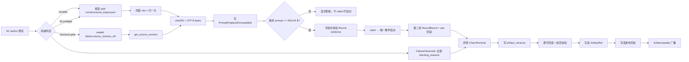

# 技术方案：SC 失败修复包与完整失败源自含教学 v1.0

## 1. 给人看的结论

WIG 单候选（SC）生成链有两个相互依赖的后续能力：

1. 失败后不能只留下第一轮和最后一轮摘要，要能回答「每一轮挡住了什么、这一轮 provider 交了什么、平台给过什么修复指令」。
2. 作者教学不能只给错误原因，要把导致本轮失败的**上一版完整 source**带回去，使作者在没有旧 provider 会话记忆时也能修正。

实现顺序固定为 **A4 证据与修复包 → A3 source resolver 与教学 prompt**。A4 先让每个 source、raw、prompt 都有真实、可回读的身份；A3 只消费这些身份，不猜“最近一次文件”。



**两条硬裁定：**

- split run 身份及 provider 原始输出落盘只扩到 SC（包含非 LC 的 SC 直连作者轮）；非 SC legacy 逐段路径不创建新 split 身份，行为不变。
- 修复包不是“调用了 update_artifact 就算成功”。A4 使用「写 → 回读逐字校验 → 成员校验 → 登记 ArtifactRef → 回读引用 → 广播」屏障；任何一步失败都必须暴露原失败和持久化失败，不能让 UI 显示“已有修复包”。

## 2. 当前代码事实与真实落点

接地材料 `cadence/analysis-docs/wig-product-flow-2026-11-13/a4a3-grounding.md` 已指出真实入口在 `src/web/workspace_ws_handler/run/`，不是题面中的 `src/product/workspace_engine/run/`。CodeGraph＋定向 read 核实的关键落点：

| 事实 | 文件／符号 |
|---|---|
| 主循环与三个终局出口 | `src/web/workspace_ws_handler/run/single_candidate.rs` 的 `run_single_candidate_author`；compile 失败约 `:843-916`，IR 约 `:939-1004`，结构门约 `:1005-1079` |
| compile/IR prompt | `src/web/workspace_ws_handler/run/single_candidate_compile_preflight.rs` 的 `build_typed_compile_reredrive_prompt`、`build_preflight_ir_reredrive_prompt`；下游 `src/product/workspace_engine/prompts/sc_compile_teaching.rs` 的 `TeachingReredriveFacts`、`render_teaching_reredrive_prompt` |
| 结构 prompt | `src/product/workspace_engine/single_candidate_structure_failure.rs:112` `author_structure_repair_prompt` |
| raw provider 输出 | `src/product/work_item_split_engine/parse.rs:626-630,650-662,752-782`；实际目录 `work-item-split-runs/{session_id}/{role_run_seq}/` |
| source revision 读写 | `src/product/work_item_plan_source_store.rs:182-245`；结构失败已有 `source_revision_ref`，compile/IR 失败轮没有 durable revision |
| source 围栏样板 | `src/product/work_item_split_engine/prompts/sc_revision.rs:69-108`，`[previous_source]` 与 `WORK_ITEM_PLAN_MARKDOWN_PROMPT_MAX_BYTES` |
| 工件版本／广播 | `src/web/workspace_ws_types/artifact.rs:19-63`，`src/product/workspace_engine/controls.rs:297-338`，`src/product/lifecycle_store/workspace_timeline_artifacts.inc.rs:198-210` |
| 尝试流水 | `src/product/lifecycle_store/candidate_attempts.rs:184-224,285-315,627-667`，只记录来源 ref／缺失原因，不记录 raw 全文 |

现状的三个直接缺口是：`first_round_failure` 不是轮次集合；compile/IR 的 split run 与失败轮没有耐久索引；`failure_source_ref` 唯一生产点写死 `None`，生产没有消费者。它们是 A4/A3 的范围，不通过改变 message 文案来掩盖。

## 3. A4：修复包、轮次和严格发布

### 3.1 载体为什么选 ArtifactPayload

候选载体有三种：

| 载体 | 代价 | 结论 |
|---|---|---|
| session record 新增大字段 | 重复保存历史，刷新 DTO／锁／兼容面扩大；不适合多轮 raw/prompt 引用 | 否决 |
| 追加 jsonl 作为唯一修复包 | 适合逐轮 append，但客户端已有 artifact 版本／引用／广播通道；需再造消费入口 | 只用作 A4 的证据底座，不作用户工件 |
| `ArtifactPayload` 新变体 | 沿 `ArtifactVersion` 版本、`ArtifactRef`、session_state 和 ArtifactUpdate 广播；客户端已有 JSON 只读面 | **采用** |

新增 wire 独立键 `sc_failure_repair_package`，包正文只带受控 locator、digest、bytes 和完整 blocking reasons，不复制大型 raw/source/prompt。source／raw／prompt 正文留在受 scope 保护的证据存储中。

既有原轮与实际发送的教学 prompt 执行事件仍保留完整 `output` 与 node detail 重连回放；immutable prompt 文件／locator 用于机器核验，不能替代用户已有全文卡片。locator-only 仅限制新增 A4「修复包已发布」成功事件；超预算未发送正文仍只作审计，不伪造已发送事件。

### 3.2 逐轮证据模型

新链 identity 由 session、SC 业务启动 key、原轮 node、原轮 role_run_seq 的长度前缀摘要组成。不能在没有 key 时以 `no-launch` 伪造 identity。round 从 1 起为拟调用分配，但必须另标 not_started／started／Unknown，RoundBound 不算真实启动；计费与物理上限只认既有 ledger。重新开始生成是新链。

每轮写以下事件（schema_version=1）：

- **RoundBound**：provider 启动前写入，携带 chain／round／node、provider、`role_run_seq`、`run_ref`。
- **FailureObserved**：机械失败后写入全部 `blocking_reasons`、失败 source 摘要、raw locator（或 missing）。compile 采 `format_compile_failure_reasons(&diagnostics)` 全集和未截断指令；IR 采 operational 后完整 failure reasons，并对只有 typed fault 的情况稳定渲染；结构门采原始 `StructuralAssessment::Rejected(failures, _)` 的 `PlanningFailureSet` 全集，不用固定一句。接地修正：当前 `author_structure_gate_failure` 构造的是 `Operational`，直接改为 `Structure` 会改变 sealed failure_id。集成 owner 已裁定保留 sealed `PlanningCompileFailure`／failure_id／detail 逐字不变，`Rejected { failure: PlanningCompileFailure, structure_failures: PlanningFailureSet }` 额外透传原 typed set；completion 在 `route_author_structure_gate_failure` 新增同名入参传入原集，seal 后随 failure 返回。旁路 set 仅用于 A4 全原因／A3 教学，不参与 seal、资格、计数、路由，不从文本反解析；source 仍从 sealed failure 自身 ref 装载。
- **PromptPrepared / PromptUnavailable**：完整 prompt 不可变正文的引用、digest、bytes、builder，或明确的无资格／来源失败／超预算／窗口已用原因。
- **ChainTerminal**：最后失败轮、终局原因、证据完整度；仅它触发组包，不将“准备过”写成“已发布”。
- **ArtifactPublished**：包文件及ArtifactRef均写读通过后，独立原子写读 `sc-failure-evidence/{chain_id}/published/{package_id}.json` 回执（不向损坏日志继续append），携带package_id/version/node/digest。重连／REST只呈现持有效回执的新A4包；磁盘残留不能冒充发布成功。

`candidate-attempts.jsonl` 仍只是一轮尝试的统计／身份流水。A4 证据通过旧 `attempt_key`／`failure_id` 关联，但不改变原字段、不追加第二条候选行；旧流水写失败沿既有非阻断诊断，新证据写／读失败则阻止 claim 或启动。

### 3.3 最后一轮的准确含义

包有两个明确字段，避免将上一轮 source 冒充最后物理轮：

- `last_provider_output`：按最大真实 provider round 取 raw；没有交付或无法回读就是 `missing`。
- `last_failure_source`：按最后一次实际机械判定取 source；若教学轮启动但无完整交付，保留真实的 `source_round_id`。

因此“最后一轮”不是 `candidate-attempts` 最后一行、目录最新文件或 prompt attempt 序号。
若教学启动被明确拒绝，拟调用轮标not_started，不将它当“最后物理轮”；Unknown保持既有等待/对账，不补造已启动或终局包。

### 3.4 修复包与持久化屏障

修复包字段至少包括：schema/package/chain/session scope、terminal class/reason、`completeness`、`rounds[]`、`last_provider_output`、`last_failure_source{sha256,bytes}`、`teaching_prompts[]`（ref/digest/bytes/builder/触发轮）、evidence log ref/digest、missing_evidence。

严格流程（采纳oracle最小集中协调，不采用高域overlay）：

1. 同一artifact_versions.json是唯一权威，两store公读始终raw。重放先按package_id核digest，同文复用原version/created_at，异文拒绝。
2. 新包及普通新版本同一个现有文件锁closure内读raw→max(version)+1→merge→save。集中save仅保磁盘A4而调用列表缺席者；普通删除/回滚照原列表。同version异文拒绝，不用len()+1或“算号释放再save”。A4恒is_current=false。
3. A4写后同锁回读原bytes、逐字比较、验证全部成员/引用/hash；expected测试用独立手写fixture，另测确定性/损坏，不用serializer自比。文件屏障后释放锁，才写读node ArtifactRef及发布回执，不跨await持锁或重取同锁。
4. 回执通过才更新raw内存versions与ArtifactUpdate；session.artifact仍普通current。mark_latest只跳A4、保持最后非A4原语义。原prompt事件全文output不变，locator-only只约束新增A4成功事件。
5. ref/receipt失败明确publication_incomplete、无成功广播。过滤只在session_state/公开REST版本视图；WS live仅成功广播、重连同session_state过滤。内部socket::lc_recovery_source_stale核business refs，不是公开历史读，保持raw。
6. pending后夹普通update/confirm/CAS回滚集中save仍保A4；解除故障同包同version/created_at恢复、provider增量0。普通新版本max+1可留诚实空洞，无第二版本域/永久staging/overlay。广播失败不撤销耐久事实。

最小闭集是store集中raw save/同锁closure、controls原子Result、timeline跳A4及最终视图；不引入第二权威。`update_artifact -> Result<ArtifactRef,String>`在安全分配/save失败时先于内存变更返回、无ref/成功广播；7生产文件14调用中13个Result显式传播，void complete_assistant_message沿已有Error＋Failed节点后return、不继续checkpoint/确认。PlanRepair只映射真实Store(ProductStoreError::Io(message))；19测试显式expect。拆成Plan P14c–f/t1–t4每片≤3文件，既有ref/broadcast错误策略不重构，普通save删除/回滚语义不扩大。memory-only因独立coding history读改写会删新A4被否决；设计选择已闭合，仅后续编译/行为证据未取得。

## 4. A3：三类 source 如何回到 prompt

### 4.1 三类来源裁定

| 失败类 | 取上一版完整 source | 失败 ref 语义 |
|---|---|---|
| compile | 读取本失败轮绑定 handle 对应 `structured_output.json`（JSON 必须为 String），再走 `prepare_author_delivery_for_compile`；这才与实际 `compile_source` 一致 | split locator；raw 和归一化 source 都各自留摘要 |
| IR 预检 | 同 compile，但必须绑定当前 IR 失败轮，不读上一成功候选 | split locator；核验 source hash／bytes |
| 结构门 | 用 sealed `failure.source_revision_ref` 调 `WorkItemPlanSourceStore::get_source_revision`，按 source scope 核验 | canonical source revision ref；不是 last-valid session ref |

`failure_source_ref` 的结论是**填真实值并新增读端**。旧记录中的 None 可反序列化，但新请求不能正常使用 None；历史 None 在 claim／启动前报 `sc_failure_source_unavailable`，A4 明确缺项，零新增启动。compile／IR 的 source revision 仍不可伪造，ref 是 split locator；结构门 ref 是 canonical revision。

compile／IR的source locator虽然指向split raw，source摘要/bytes却明确对归一化后的完整source计量；必须先读本轮raw并核raw摘要，再同源归一化/去preamble后核source摘要，二者可以不同。结构revision摘要直接核revision.source。请求构造器按Plan显式接收resolved source、typed kinds、已写读prompt evidence与原instruction_digest；compile/IR沿原指令/原因join摘要，结构仍摘要原不含source的修复指令正文，由同文件纯helper供新模板和摘要共同消费，不能把source注入暗改旧指令摘要。

### 4.2 注入格式

compile／IR 的 `TeachingReredriveFacts` 增加不可省略的 previous source 和来源元数据；`render_teaching_reredrive_prompt` 统一渲染。结构门 `author_structure_repair_prompt` 也接收 source，但 I/O 留在 runner：sealed failure 随 `Rejected` 返回，runner 先 resolve 再交给纯 prompt 构造器。

统一块放在 typed 失败事实之后、最终完整输出指令之前：

````markdown
[previous_source]
本轮必须在以下上一版完整 source 基础上修复，正文逐字保留；来源不是旧会话记忆。
source_ref: sc-split-output/v1/session/17
source_sha256: <64-lower-hex>
source_bytes: <N>
origin: compile_split_output

```markdown
# Work Item Plan
...
```
````

为避免 source 自己包含三反引号导致提前闭栏，围栏长度是 source 内最长连续反引号串加一（至少三）；不 `.trim()`、不转义、不删除首尾空白。包装分隔换行不计入 source hash/bytes。

### 4.3 `failure_source_ref` 的真实消费

在教学请求建立、claim 和启动前，resolver 读取 ref，校验 session／project／issue／plan scope，并对同一 text 计算失败 source SHA-256 与 UTF-8 bytes。ref、摘要、正文三者任一不一致即 `sc_failure_evidence_invalid`，不拿内存 source、其它轮 raw 或 last-valid ref 补齐。

这不是把 ref 填进 session 就结束：`ScTeachingWindowRequest` 当前 frozen digest 仍按既有业务／材料／context／failure_source_sha256 口径，不随路径字符串扩张；但所有新请求都必须完成真实 resolver 读取，才能进入 claim。路径是可验证来源，digest 是内容身份；二者职责不混。
新窗口的 `prompt_ref` 同样填真正可回读的教学全文 locator，`prompt_digest` 对该正文计算；builder 名另存 `builder_id`。既有冻结输入比较继续约束 ref/digest，旧窗口不倒填或改写。

接口注意：`SingleCandidateAuthorCompletion::Rejected` 改携带sealed `PlanningCompileFailure` 后，该内部enum去掉Eq derive（PlanningCompileFailure当前只有PartialEq），保留PartialEq并迁移全部Rejected模式。最终prompt facade返回含全文和budget_verdict的ScPreparedTeachingPrompt；超过预算的全文先审计再显式拒绝，不能内部早退丢掉正文引用。

## 5. 超预算与失败关闭

字节闸口是 `WORK_ITEM_PLAN_MARKDOWN_PROMPT_MAX_BYTES`，定义于 `src/product/work_item_split_engine/prompts.rs:39`，值 262,144。判定是**最终交给 provider 的完整教学 prompt** `.as_bytes().len()`，包含 source 围栏、source 元数据、typed 事实、A1 省略计数、合法 ID、IR 追加尾段和输出指令；不是 char 数、token、source 单体大小，也不是现有 32,000 B parse 事实块。

- `<=262,144`：继续既有 claim／最多一次教学启动。
- `>262,144`：返回 `sc_teaching_prompt_budget_exceeded`，写完整 prompt 的审计 ref/digest/bytes 并标 `rejected_budget`，不发送、不 claim、不启动；进入终局 A4 包。
- prompt 审计写／读失败：`sc_teaching_prompt_persist_failed`，不以 builder 名、事件 ID 或 digest 冒充正文引用。
- source 读失败或 hash 不符：`sc_failure_source_unavailable`／`sc_failure_evidence_invalid`，不摘要替代、不截断、不静默跳过 source。

因此 A3 采用与 `sc_revision.rs:100-106` 同构的 fail-closed 拒绝，而不是 A1 的“完整诊断条目省略”。两种预算对象独立：A1 仍按 REQ-WSC-32 ≤32,000 B 整条省略并审计；A3 对完整 source 不允许省略。

## 6. 影响面、取代关系与非目标

承接已归档 `repair-wig-fact-projections` §9 的 A4、A3；不重复 A1/B/C/D 已闭合内容。非 SC legacy 不增加 split 身份；不新增模型调用／重试／预算、不改 typed 资格、claim、A/B 池、结构安全边界、success／Routed／waiting／Superseded 语义。

客户端新增 `sc_failure_repair_package` 类型与识别，仅提供只读摘要／JSON；不新增恢复按钮。Rust 侧需补 ArtifactPayload、session summary 与测试 helper 的穷尽匹配；前端闭集包括 artifact 类型、wire/session/REST 归一化、WS 消息识别、摘要和严格 switch。旧变体必须继续往返。

## 7. 逐落点行数账（设计估算）

基线由当前 worktree `wc -l` 取得；净增不是已实施 diff。硬规则：常规源码和测试不超过 1200 行；`large_file_guard` 位于 `tests/it_core/large_file_guard.rs`，上限常量为 1200，grandfathered 只能删项；`single_candidate.rs` 当前 1199 行，`preflight.rs` 1180 行，故净正增长禁止。

| 落点 | 当前 | 预计净增 | 腾挪／结果 |
|---|---:|---:|---|
| `src/web/workspace_ws_handler/run/single_candidate.rs` | 1199 | **目标≤1180** | 先迁84行transport；再迁三段终局message装配至少40行，预计接线+60；硬线1200不变，禁止压行 |
| `src/web/workspace_ws_handler/run/single_candidate_compile_preflight.rs` | 1180 | **-68** | prompt wrapper／IR尾段迁入新 facade，保留资格与预检；目标约1112 |
| `src/web/workspace_ws_handler/run/single_candidate_structure_reredrive.rs` | 865 | **-60** | source／证据适配与 prompt wrapper迁出，目标约805 |
| `src/web/workspace_ws_handler/run.rs` | 221 | +6 | 注册新 SC transport/evidence/prompt 模块，目标227 |
| `run/sc_failure_transport.rs`（新） | 0 | +240 | 承接 reredrive driver、SC 专用 split strict close；≤1200 |
| `run/sc_failure_evidence.rs`（新） | 0 | +300 | 三类事实采集、ChainTerminal 组装；≤1200 |
| `run/sc_teaching_source.rs`（新） | 0 | +180 | source resolver、scope/hash/bytes；≤1200 |
| `run/sc_teaching_prompt.rs`（新） | 0 | +160 | wrappers、最终 budget；≤1200 |
| `src/product/lifecycle_store/mod.rs` | 57 | +1 | 注册 evidence module，目标58 |
| `lifecycle_store/sc_failure_evidence.rs`（新） | 0 | +330 | rounds.jsonl、prompt正文、严格读；≤1200 |
| `work_item_split_engine/parse.rs` | 866 | +8 | 暴露受控 handle→目录读辅助，目标874 |
| `lifecycle_store/workspace_timeline_artifacts.inc.rs` | 242 | 约+90 | 唯一save锁内保A4、append/publisher同锁max+1；公读raw不变，目标≤400 |
| `src/web/workspace_ws_types/sc_failure_repair.rs`（新） | 0 | +180 | A4 DTO与显式证据状态；≤1200 |
| `src/web/workspace_ws_types/artifact.rs` | 235 | +6 | 变体与两个 match 臂，目标241 |
| `src/web/workspace_ws_types/mod.rs` | 30 | +2 | 新类型模块／导出，目标32 |
| `workspace_engine/mod.rs` | 244 | +5 | strict artifact／source block／summary helper注册，目标249，各片串行 |
| `workspace_engine/sc_failure_artifacts.rs`（新） | 0 | +240 | 组包、写读发布屏障；≤1200 |
| `workspace_engine/single_candidate.rs` | 1046 | 0 | Rejected typed failure 替换旧 prompt参数，净零 |
| `single_candidate_structure_failure.rs` | 386 | +8 | sealed failure 透传，仍远低于1200 |
| `prompts/sc_compile_teaching.rs` | 566 | +15 | facts／source renderer调用，目标581 |
| `workspace_engine/sc_teaching_source_block.rs`（新） | 0 | +80 | 两类 prompt 共同围栏；≤1200 |
| `work_item_plan_policy/types.rs` | 793 | 0 | 仅语义注释／核验入口由 resolver承担，目标793 |
| `workspace_engine/prompts.rs` | 1549 | 0 | 不增长；仅沿现有 re-export 接口，超1200由既有 grandfathered维持 |
| `candidate_attempts.rs` | 899 | 0 | 身份与 schema 不变 |
| `gateway_start.rs` | 991 | 0 | 通用 legacy 不改；SC wrapper在新文件 |
| `controls.rs`／`session_state/timeline.rs` | 340／734 | 约+25／+6 | 仅原子分配保存／mark_latest跳A4；目标≤380／≤750，不重构普通业务 |
| `src/product/workspace_engine/session_state.rs` | 1366 | **约-67** | summary迁出97行、视图/白名单约+30；目标≤1300且比原1366净减，1457登记不提高 |
| `workspace_engine/sc_failure_artifact_summary.rs`（新） | 0 | +115 | 承接既有全变体summary并补A4，≤1200 |
| `workspace_engine/review/tests_policy_routing.rs` | 1200 | **-21** | artifact_variant迁新helper并补新variant，目标1179 |
| `workspace_engine/review/tests_policy_routing_artifact.rs`（新） | 0 | +25 | 原测试文件path module接入，≤1200 |
| `web/src/api/types/work-item-plan.ts` | 700 | +4 | union与新DTO导出，目标704 |
| `web/src/api/types/sc-failure-repair.ts`（新） | 0 | +140 | A4 DTO镜像，不挤大wire文件 |
| `web/src/api/types/workspace.ts` | 1198 | **-35** | 用命名wire alias收敛四处重复artifact联合，保留所有原分支，目标1163 |
| `web/src/hooks/workspace-ws-message-handler.ts` | 1061 | +8 | 新键识别不落markdown，目标1069 |
| `web/src/state/workspace-ws-store-helpers.ts` | 655 | +12 | session与版本归一化，目标667 |
| `web/src/pages/ChatWorkspacePageParts.tsx` | 387 | +7 | REST平铺／归一化两种载荷，目标394 |
| `web/src/state/work-item-plan-artifact-summary.ts` | 145 | +15 | 专属只读摘要，目标160 |
| `web/src/components/workspace/work-item-plan-projection-artifacts.ts` | 46 | +2 | 穷尽label，目标48 |
| `web/src/components/workspace/WorkItemPlanArtifactPanel.tsx` | 361 | +4 | 默认json tab、失败包文案，目标365 |
| `web/src/components/workspace/WorkItemPlanArtifactContent.tsx` | 813 | 0 | 复用现有JSON视图，不新造UI |
| `workspace_engine/tests/single_candidate/author_structure_gate_reredrive.rs` | 339 | +20 | Rejected接口与来源断言，目标359 |
| `handler/tests/single_candidate_teaching_window_fault_matrix.rs` | 699 | +20 | ref夹具，目标719 |
| `workspace_ws_types/tests/artifact_version_roundtrip.rs` | 200 | +35 | 新wire变体，目标235 |
| `workspace_engine/tests.rs` | 80 | +2 | 新publisher测试模块，目标82 |
| `workspace_ws_handler/tests.rs` | 1167 | +2 | 新failure/source矩阵模块，目标1169 |
| `workspace_ws_types/tests.rs`／`workspace_engine/tests/single_candidate.rs` | 1154／1551 | 0 | 复用已注册测试，1551行宿主零增长 |
| 新测试：engine/tests/sc_failure_artifacts.rs、handler/tests/sc_failure_package.rs / sc_teaching_source.rs、web/src/state/sc-failure-repair.test.ts | 0 | 各+300（上界400） | 独立文件；module登记已记账或vitest自动发现 |
| `run/single_candidate_ir_prompt_tests.rs` | 47 | +12 | 仅测试builder同步显式source/Result，目标59 |

> `src/product/workspace_engine/prompts.rs` 既有登记上限1681，本change净零；`session_state.rs` 既有登记1457，本change净减90。新增文件与正增消费点均在1200以内，不修改large_file_guard登记。表中缩写 `workspace_engine`／`handler`／`run` 分别对应 `src/product/workspace_engine`／`src/web/workspace_ws_handler`／其run目录；`workspace_ws_types` 对应 `src/web/workspace_ws_types`。

## 8. 工作包与门禁

26 个包已写入 OpenSpec `tasks.md`，先 W01–W04 契约，后 W05–W18 实现（W11a–g消费闭集各≤3文件／≤3h），最后 W19–W20 门禁。实现阶段必须逐包执行 REQ-WSC-33/34/35 场景；W10严格屏障与W11g发布读屏障独立验收，不能隐藏在普通artifact更新中。共享文件按设计切片串行接线，不在本轮实施。

完成实现后的真实命令：

```text
openspec validate deliver-sc-failure-repair-package --strict
openspec validate --specs --strict
cargo test --locked --test it_core large_file_guard
```

本设计阶段不运行 Rust／前端测试；OpenSpec 两条命令在本轮全部契约写完后真实执行，输出见交付说明。不得把设计文档或spec validate绿色解释为Rust已实现。
